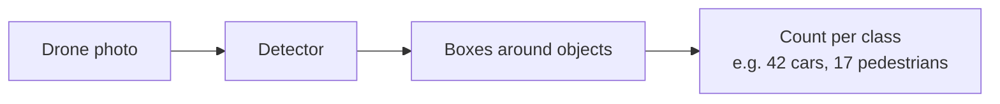
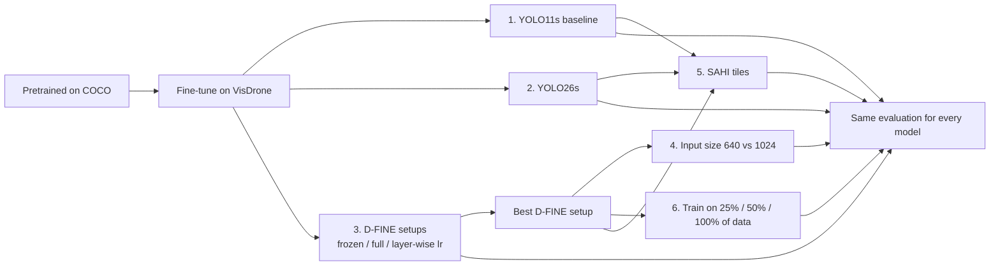
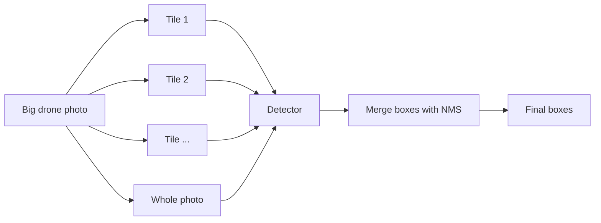
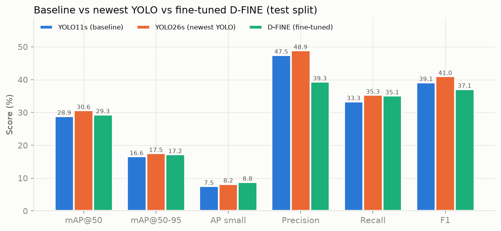
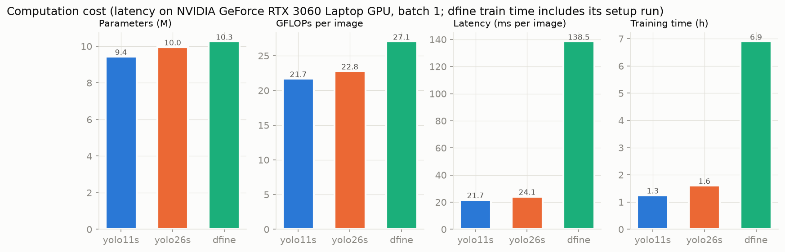
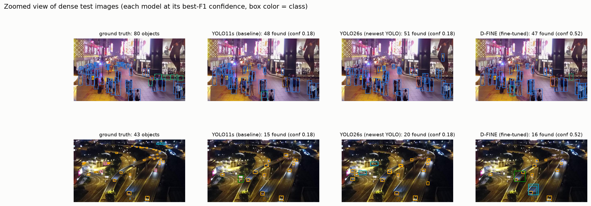
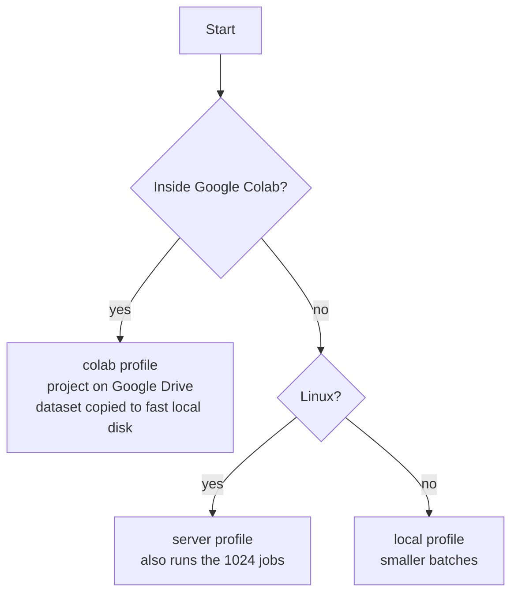
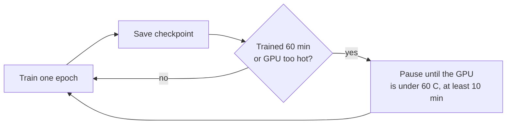
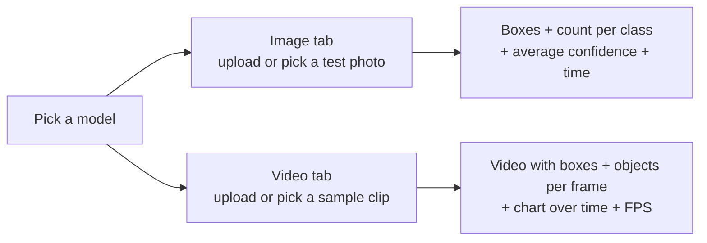

### SkyScout

**Fine-Tuning and Benchmarking YOLO and Transformer Detectors for Small-Object Detection in Drone Imagery**

Francis Neil Moral, TensorFlow II course project, Fanshawe College

#### What is this project about?

Drones take photos from high up, so people, bikes and cars look tiny. Most object detectors are trained on normal photos where objects are big, so they miss a lot of these tiny things.

SkyScout takes three ready-made detectors that already know common objects, teaches them to find 10 kinds of road objects in drone photos, and then checks which one is the most accurate and which one is the fastest.



#### The three detectors

| Model | Type in plain words | Why it is here |
|---|---|---|
| YOLO11s | A fast CNN that looks at the image once. Needs an extra clean-up step (NMS) to remove duplicate boxes | Baseline, same as the class example |
| YOLO26s | The newest YOLO. Also looks once, but no clean-up step needed | Shows how much newer YOLO helps |
| D-FINE Small | A transformer that treats detection as "fill in a list of objects". End-to-end, anchor-free, no clean-up step | The TensorFlow/Keras part of the project |

All three are about the same size (around 10 million parameters), so the comparison is fair.

```mermaid
flowchart TB
    subgraph YOLO["YOLO11s (CNN)"]
        y1[Image] --> y2[CNN backbone] --> y3[Many candidate boxes] --> y4[NMS removes duplicates] --> y5[Final boxes]
    end
    subgraph Y26["YOLO26s (CNN, NMS-free)"]
        n1[Image] --> n2[CNN backbone] --> n3[One box per object] --> n5[Final boxes]
    end
    subgraph DF["D-FINE (transformer)"]
        d1[Image] --> d2[CNN backbone] --> d3[Transformer encoder] --> d4[Decoder with 300 object queries] --> d5[Final boxes]
    end
```



#### The data: VisDrone2019-DET

- About 10,000 drone photos from Chinese cities, mostly around 2000 x 1500 pixels
- 10 classes: pedestrian, people, bicycle, car, van, truck, tricycle, awning-tricycle, bus, motor
- Most objects are smaller than 32 x 32 pixels, which is what makes this dataset hard. The exact counts per split and class are written to `results/dataset_summary.md` when the data is prepared.

#### What we test



1. **Baseline:** YOLO11s at 640 px
2. **Newest YOLO:** YOLO26s at 640 px
3. **D-FINE fine-tuning setups:** train only the head (frozen backbone), train everything, or train everything with smaller learning rates for the early layers (layer-wise learning rate decay). The winner is trained longer.
4. **Bigger input:** 640 vs 1024 px. Bigger input keeps tiny objects bigger, but costs more time.
5. **SAHI tiled inference:** cut the photo into overlapping tiles, detect on each tile, then join the results. Like using a magnifying glass on each part of the photo.
6. **Data efficiency:** how good is D-FINE with only a quarter or half of the training photos?



#### How we score the models

| Score | Meaning |
|---|---|
| mAP@50 | How well boxes are found when a loose overlap (50%) counts as correct |
| mAP@50-95 | Same, averaged over loose to very strict overlaps. The main score |
| AP small | mAP@50-95 for objects under 32 x 32 pixels only |
| Precision | Of the boxes the model drew, how many were right |
| Recall | Of the real objects, how many the model found |
| F1 | Balance of precision and recall |
| Latency | Milliseconds per image on the same GPU (NMS time shown separately for YOLO11) |
| Parameters / FLOPs | Model size and amount of math per image |
| Train time | Hours of training, added up over every session (and which GPU did it) |

Every model goes through the same evaluation code on the same split. Each model gets a results card like this one in `results/<model>/test/report.md`, plus a per-class table and a confusion matrix:

| Metric | Score (%) |
|---|---|
| mAP@50 | ... |
| mAP@50-95 | ... |
| Precision | ... |
| Recall | ... |
| F1 Score | ... |
| Parameters | ... |
| FLOPs | ... |

Every report also says how long training and evaluation took. The final comparison table and plots (accuracy vs speed, setups, input size, SAHI, data efficiency, sample predictions) are in `results/comparison.md`.

FLOPs are counted the same way for every model: 2 x the multiply-adds of all conv and linear layers for one 640 x 640 image (Ultralytics does this for YOLO, SkyScout does it for D-FINE by running one image through the model and reading each layer's real shapes).

#### Results (first run on a laptop GPU)

All 640 px runs were trained on one laptop GPU with shorter schedules (YOLO 50 epochs, D-FINE setups 6 epochs, then 10 more for the best setup). Scores are on the 1,610 test-dev images, latency is batch 1 on that same GPU.

| Model | mAP@50 | mAP@50-95 | AP small | Params (M) | GFLOPs | Latency (ms) | Train time (h) |
|---|---|---|---|---|---|---|---|
| YOLO11s (baseline) | 28.9 | 16.6 | 7.5 | 9.4 | 21.7 | 21.7 | 1.3 |
| YOLO26s (newest YOLO) | **30.6** | **17.5** | 8.2 | 10.0 | 22.8 | 24.1 | 1.6 |
| D-FINE fine-tuned (6 + 10 epochs) | 29.3 | 17.2 | **8.8** | 10.3 | 27.1 | 138.5 | 6.9 |
| YOLO26s + SAHI | 37.0 | 21.0 | 12.9 | 10.0 | 22.8 | 89.1 | 1.6 |
| D-FINE + SAHI | 33.3 | 19.4 | 11.5 | 10.3 | 27.1 | 413.9 | 6.9 |

What we found:

- YOLO26s beats the YOLO11s baseline on every score for almost the same size and speed.
- D-FINE ends up between the two YOLOs on mAP and is the best on small objects, even with only 16 epochs. It is much slower here because the KerasHub model runs as a plain TensorFlow graph (no TensorRT or fused kernels).
- Full fine-tuning was the best D-FINE setup (val mAP@50-95 18.9 vs 18.4 with layer-wise LR decay and 18.3 with a frozen backbone).
- SAHI tiles help every model on small objects (AP small +4.6 for both YOLOs, +2.7 for D-FINE) but cost 3 to 4 times the latency.
- With 25%, 50% and 100% of the training images, D-FINE scores 10.4, 12.9 and 15.5 mAP@50-95 (6 epochs each), so more data still helps.







Demo screenshots of the same test image with each model are in `results/screenshots/`.

#### Files

| File | What it is |
|---|---|
| `SkyScout.ipynb` | The notebook. Run it top to bottom |
| `skyscout.py` | All the code: data, training, evaluation, report, demo, command line |
| `config.yaml` | Every hyperparameter and setting. Change values here |
| `requirements.txt` | Python packages |
| `downloads/` | Dataset and pretrained weights (downloaded once, never again) |
| `runs/` | Training checkpoints and logs |
| `models/` | Final fine-tuned models |
| `results/` | Metrics, tables, plots, `STATUS.md` and `log.txt` |

#### How to run

The code works out where it is running and picks the matching settings in `config.yaml`:



Recommended: set `SKYSCOUT_PROFILE=colab`, `server` or `local` to override the guess.

**Google Colab**
1. Open `SkyScout.ipynb` in Colab and pick a GPU runtime.
2. Run the cells in order. The first cell mounts Google Drive and clones this repo into `MyDrive/SkyScout` if it is not there yet.

Recommended: if the repo is private, upload the project folder to Google Drive as `MyDrive/SkyScout` instead.

**School server or own PC**
```bash
pip install -r requirements.txt
python skyscout.py status          # what is done and what is next
python skyscout.py all             # run everything this machine is allowed to run
python skyscout.py run yolo11s_1024
python skyscout.py time dfine_full_640
python skyscout.py eval yolo26s_640 --split test --sahi
python skyscout.py latency         # time every saved model again on this machine's GPU
python skyscout.py report
python skyscout.py demo
```
`all` starts each experiment in its own Python process, so TensorFlow and PyTorch never fight over GPU memory, and one failed run does not stop the rest.

Recommended: if the server has more than one GPU, pick a free one with `CUDA_VISIBLE_DEVICES=1 python skyscout.py all`.

**Own Windows PC**

TensorFlow cannot use the GPU on plain Windows, so D-FINE is trained inside WSL2 (Ubuntu), which the code treats as the `local` profile. This profile uses shorter training (YOLO 50 epochs, D-FINE 6 epochs per setup) so everything fits on one laptop GPU in about a day, and it takes cooling breaks:



Breaks are not counted in the training time. Change or remove them with `cooldown` under `profiles: local:` in `config.yaml`.
Recommended: on the server, start long jobs with `nohup python skyscout.py all > results/server_run.txt 2>&1 &` so they keep going after you log out.

#### Interruptions and moving between machines

Nothing is lost when Colab disconnects or you switch machines:

- YOLO saves `last.pt` every epoch and continues from it. The saved paths are rewritten so it also resumes on a different machine.
- D-FINE saves the full training state (weights, optimizer, epoch) every epoch and continues from it.
- Evaluation saves its detections every 200 images and continues from there.
- Each step (train, evaluate, SAHI) writes a small file in `results/progress/` with its status, the current epoch and the time spent so far. Finished steps are skipped.
- Downloads are checked first, so nothing is downloaded twice.
- `results/STATUS.md` shows what is done on which machine.

Recommended: when you move to another machine, copy the `runs/`, `models/` and `results/` folders along with the code. Copying `downloads/` too saves the download time.

#### Demo

`python skyscout.py demo` (or the last notebook cell) opens a small web app for trying the models out. The scores were already measured in the evaluation step, the app shows them next to the chosen model.



- **Image:** boxes drawn in a color per class, a table with the count and average confidence per class, and how long it took.
- **Video:** the video comes back with boxes, plus the average and highest count per class and a line chart of objects over time. Counts are per frame (no tracking), so a car seen in 10 frames counts 10 times.
- A short sample clip is built from one VisDrone test-dev sequence the first time. Put any other `.mp4` in `downloads/samples/` and it shows up as an example too.
- Turn on tiled inference (SAHI) to find even smaller objects, at the cost of speed.

Recommended: on the school server, open the demo through an SSH tunnel (`ssh -L 7860:localhost:7860 ...`) and go to `http://localhost:7860`.

#### A note on D-FINE in KerasHub

Two changes were needed to fine-tune D-FINE from KerasHub on this dataset:

- The built-in training loss treats empty padding slots as real objects and mixes up objects between images in a batch. SkyScout uses a corrected loss (`SkyDFine` in `skyscout.py`).
- Loading the preset with a new number of classes throws away the pretrained weights. SkyScout copies them over itself, so only the new class layers start from scratch.
