### SkyScout

**Fine-Tuning and Benchmarking YOLO and Transformer Detectors for Small-Object Detection in Drone Imagery**

Francis Neil Moral, TensorFlow II course project, Fanshawe College

[](https://colab.research.google.com/github/fnmoral/skyscout-small-object-detection-yolo-vs-dfine-visdrone/blob/main/Demo.ipynb) Try the trained models in your browser: click the badge, then **Runtime > Run all**.

#### What is this project about?

Drones take photos from high up, so people, bikes and cars look tiny. Most object detectors are trained on normal photos where objects are big, so they miss a lot of these tiny things.

SkyScout takes three ready-made detectors that already know common objects, teaches them to find 10 kinds of road objects in drone photos, and then checks which one is the most accurate and which one is the fastest.

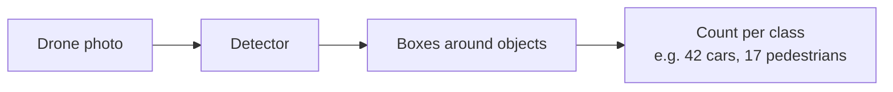

#### The main question

**Which finds small objects in drone photos better: CNN detectors (YOLO) or a transformer-based detector from the DETR family (D-FINE), and what does each one cost in speed and training time?**

- CNN side: YOLO11s (baseline) and YOLO26s (newest YOLO)
- Transformer side: D-FINE Small (CNN backbone + transformer encoder-decoder)

D-FINE is not a pure transformer. Like the other DETR-family detectors (DETR, Deformable DETR, RT-DETR), it uses a CNN backbone to pull features out of the image and then transformer attention with object queries to find the objects. All three models therefore start from a CNN backbone, and the comparison is about how objects are found: dense convolutional predictions (YOLO) against attention and object queries that output a set of boxes (D-FINE).

Scope: pure transformer detectors (for example YOLOS, which uses only a ViT) and large vision-language models that can point at objects (for example Qwen2.5-VL) were left out. At the same small size pure transformer detectors are much less accurate and slower, especially on small objects, and vision-language models are hundreds of times bigger and take seconds per image, which does not fit real-time drone detection.

Around the main question, the project also answers some smaller ones:

| Part | Question |
|---|---|
| Old vs new YOLO | Does YOLO26s improve on the YOLO11s baseline? |
| D-FINE fine-tuning setups | Is it better to freeze the backbone, train everything, or train everything with smaller learning rates for early layers? |
| SAHI tiling | Does cutting the photo into tiles help both kinds of model find small objects? |
| Data efficiency | How much does D-FINE need all of the training data? |
| Input size | Does a bigger input (1024 vs 640 px) help? (needs the school server, not done yet) |

Short answer from the first run (details in [Results](#results-first-full-run)):

- Small objects: the transformer (D-FINE) is best, AP small 8.8 vs 7.5 (YOLO11s) and 8.2 (YOLO26s)
- Overall accuracy: the newest CNN (YOLO26s) is slightly ahead, mAP@50-95 17.5 vs 17.2 (D-FINE) and 16.6 (YOLO11s)
- Speed and training: the CNNs are about 6 times faster and train much quicker
- SAHI tiles help both kinds of model on small objects, the YOLOs a bit more

#### The three detectors

| Model | Detector type | Type in plain words | Why it is here |
|---|---|---|---|
| YOLO11s | One-stage, anchor-free CNN | A fast CNN that looks at the image once. Needs an extra clean-up step (NMS) to remove duplicate boxes | Baseline, same as the class example |
| YOLO26s | One-stage, anchor-free CNN | The newest YOLO, a newer and more accurate CNN that also looks once. Run here with the same clean-up step (NMS) as YOLO11s | Shows how much newer YOLO helps |
| D-FINE Small | End-to-end, anchor-free transformer detector (DETR family) | A CNN backbone plus a transformer that treats detection as "fill in a list of objects". No clean-up step | The TensorFlow/Keras part of the project |

All three are about the same size (around 10 million parameters), so the comparison is fair.

YOLO26s also has a second, NMS-free head (one box per object, made for edge devices). Ultralytics only uses it when asked (`nms=False`), and this project ran YOLO26s in the default mode with NMS, so YOLO11s and YOLO26s are compared the same way. D-FINE is NMS-free by design.

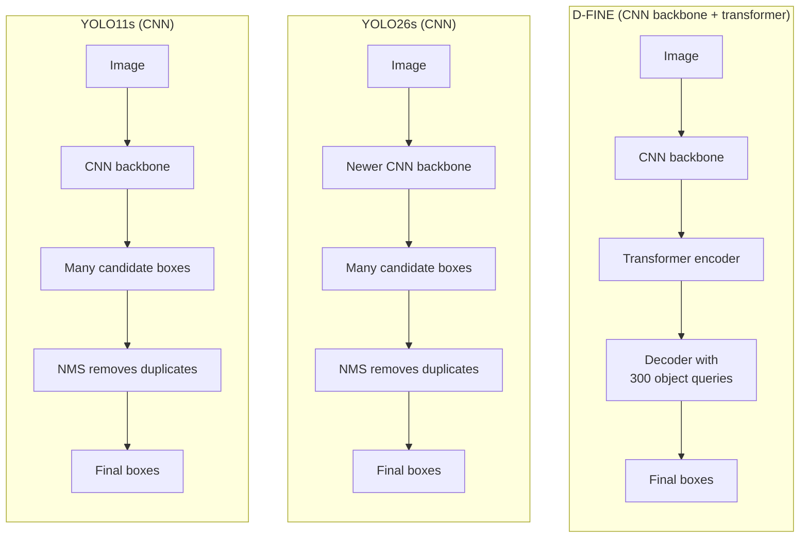

#### One-stage, two-stage and end-to-end detectors

- **Two-stage detectors** first suggest regions that might hold an object (region proposals), then classify and fine-tune each region. Accurate but slower. This is the R-CNN family.
- **One-stage detectors** skip the proposals and predict boxes and classes for every position of a grid in one pass, then remove duplicate boxes with NMS. Fast. YOLO11s and YOLO26s are one-stage.
- **End-to-end (set prediction) detectors** use a fixed set of learned object queries. Each query becomes at most one object, so there are no proposals and no NMS. D-FINE belongs to this DETR family, which is why it is described as an end-to-end detector and not as one-stage or two-stage.

| Model | Type | Region proposals | Feature extraction | Duplicate removal | Main idea |
|---|---|---|---|---|---|
| R-CNN | Two-stage | Selective search (about 2,000 regions) | CNN run on every region | NMS | First detector built on CNN features |
| Fast R-CNN | Two-stage | Selective search | CNN once per image, RoI pooling | NMS | Shared feature map |
| Faster R-CNN | Two-stage | Learned region proposal network (RPN) | CNN once per image | NMS | Proposals are learned too |
| Mask R-CNN | Two-stage | RPN | CNN once per image, RoIAlign | NMS | Adds object masks |
| YOLO11s | One-stage | None, dense predictions on 3 grids | CNN once per image | NMS | One fast pass, anchor-free |
| YOLO26s | One-stage | None, dense predictions on 3 grids | CNN once per image | NMS (as run here, an NMS-free head exists) | Newer blocks, simpler box output |
| D-FINE | End-to-end (DETR family) | None, 300 learned object queries | CNN once, then a transformer | None needed | Attention and queries give one box per object, box edges refined step by step |

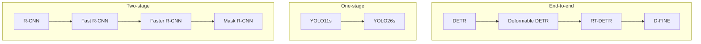

#### Inside the models: CNN building blocks

Checked by counting the layers of the trained models (YOLO in PyTorch, D-FINE in Keras), not taken from papers.

| Concept | YOLO11s | YOLO26s | D-FINE (HGNetV2 backbone + hybrid encoder) |
|---|---|---|---|
| Depthwise convolution | Yes: classification branch of the head and the attention block (7 layers) | Yes: same places, two heads (14 layers) | Yes: 5 x 5 depthwise in the light blocks, 3 x 3 depthwise in the down-sampling layers (14 layers) |
| Pointwise convolution (1 x 1) | Yes (46 layers) | Yes (67 layers) | Yes (59 layers) |
| Depthwise separable convolution | Yes: head classification branch (3 x 3 depthwise, then 1 x 1) | Yes: same | Yes: light blocks (1 x 1, then 5 x 5 depthwise) and down-sampling (1 x 1, then 3 x 3 depthwise with stride 2) |
| Residual connections | Yes: every bottleneck inside the C3k2 blocks adds its input back (11) | Yes (13) | Yes: around every attention and feed-forward layer of the transformer. The backbone mostly joins features by concatenation instead |
| Bottleneck blocks | Yes: bottlenecks inside C3k2 (CSP design) | Yes | Partly: CSP layers built from RepVGG blocks (3 x 3 and 1 x 1 branches added together) |
| Inverted residual blocks | No | No | No |
| Linear bottlenecks | No | No | No |
| Squeeze-and-Excitation | No | No | No: HGNetV2 has "squeeze" and "excitation" 1 x 1 convolutions after concatenation, but no global pooling and gating, so it is not SE |
| Compound scaling | Partly: the n/s/m/l/x sizes scale depth and width together (s = 0.5 depth, 0.5 width), input size is set separately | Partly: same | Partly: the N/S/M/L/X sizes scale backbone and encoder together |
| Inception modules | No | No | No |
| Factorized convolutions | No: only 3 x 3 and 1 x 1 (depthwise separable is the only kind of factorizing) | No | No: 1 x 1, 2 x 2, 3 x 3 and 5 x 5 kernels |
| Other notable parts | SPPF (pooling at several sizes), C2PSA (a small attention block) | Same as YOLO11s, box output without DFL (reg_max 1) | Learnable affine blocks, deformable attention, fine-grained box refinement (FDR) |

#### Why a CNN backbone + transformer and not a Vision Transformer

- **Patches are too big for tiny objects.** A Vision Transformer (ViT) cuts the image into 16 x 16 pixel patches. Most VisDrone objects are under 32 x 32 pixels, so many of them cover one patch or less and their detail is mixed away in the first step.
- **Only one scale.** A plain ViT gives one feature map. Detecting tiny and large objects needs several scales, which the CNN gives for free (stride 8, 16 and 32).
- **Cost grows fast with image size.** Self-attention compares every patch with every other patch, so the cost grows with the square of the number of patches. Drone photos are large, a CNN grows only linearly.
- **Small ViT detectors are weak.** ViTs need very large pretraining data, and at this size a pure ViT detector (YOLOS-Tiny) is far less accurate than D-FINE-S.
- **The hybrid keeps the best of both.** The CNN backbone does the cheap local and multi-scale work, and the transformer is used only where it helps: global context on the smallest feature map, and object queries that give one box per object without NMS. D-FINE's deformable attention looks at a few points per query, which keeps it fast.

#### How a photo or video goes through each model

YOLO11s and YOLO26s (as run in this project):

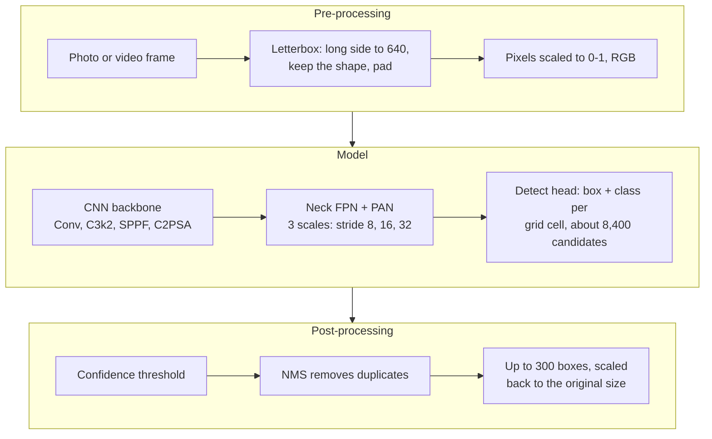

D-FINE:

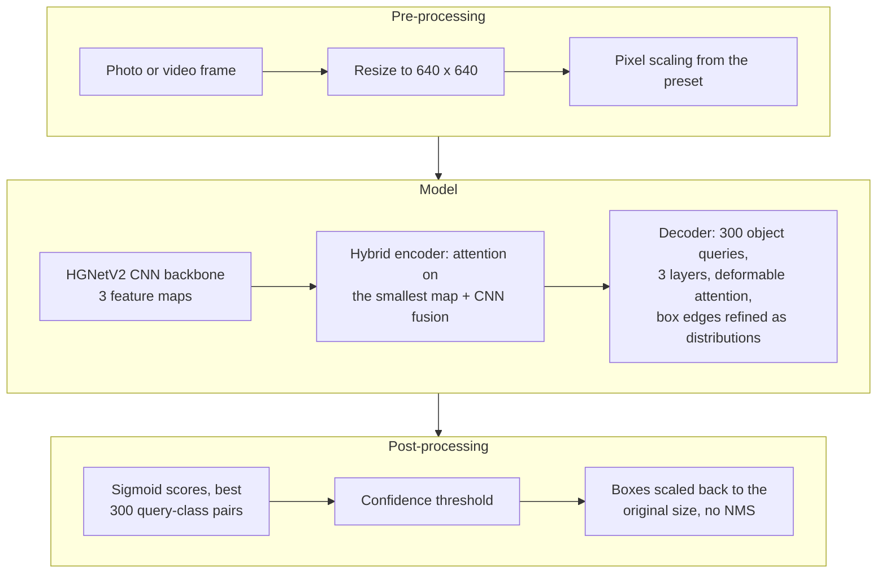

SAHI tiled inference (any model):

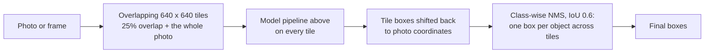

Video (demo):

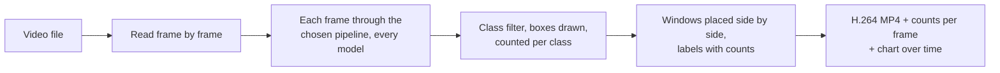

#### The data: VisDrone2019-DET

- About 10,000 drone photos from Chinese cities, mostly around 2000 x 1500 pixels
- The raw annotations have 12 categories: ignored regions (0), pedestrian, people, bicycle, car, van, truck, tricycle, awning-tricycle, bus, motor and others (11)
- **10 classes are used**: pedestrian, people, bicycle, car, van, truck, tricycle, awning-tricycle, bus, motor. "Ignored regions" (areas too crowded or unclear to label) and "others" are dropped, and so are boxes the dataset marks to be ignored (score 0)
- Pedestrian is a person standing or walking, people is a person in another pose (sitting, lying, riding)

| | Classes |
|---|---|
| VisDrone raw annotations | 12 categories |
| Used for training and scoring | 10 (ignored regions and others removed) |
| Pretrained models before fine-tuning | 80 COCO classes (D-FINE was pretrained on Objects365 first, then COCO) |
| Fine-tuned models | 10 VisDrone classes: the 80-class output layer is replaced by a new 10-class layer |

COCO already has person, bicycle, car, motorcycle, bus and truck, so the pretrained features help. VisDrone splits person into pedestrian and people and adds van, tricycle and awning-tricycle, which is one reason the output layer is trained again.
- Most objects are smaller than 32 x 32 pixels, which is what makes this dataset hard. The exact counts per split and class are written to `results/dataset_summary.md` when the data is prepared.

#### What we test

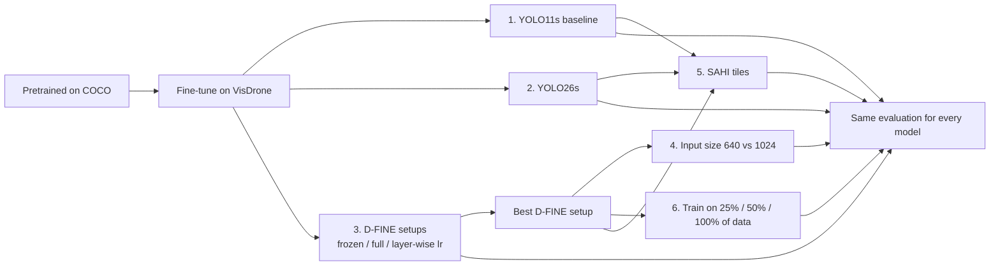

1. **Baseline:** YOLO11s at 640 px
2. **Newest YOLO:** YOLO26s at 640 px
3. **D-FINE fine-tuning setups:** train only the head (frozen backbone), train everything, or train everything with smaller learning rates for the early layers (layer-wise learning rate decay). The winner is trained longer.
4. **Bigger input:** 640 vs 1024 px. Bigger input keeps tiny objects bigger, but costs more time.
5. **SAHI tiled inference:** cut the photo into overlapping tiles, detect on each tile, then join the results. Like using a magnifying glass on each part of the photo.
6. **Data efficiency:** how good is D-FINE with only a quarter or half of the training photos?

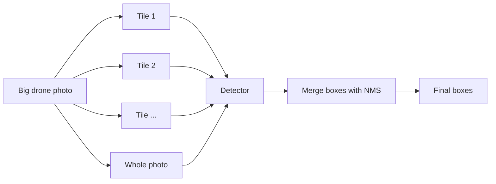

#### How we score the models

| Score | Meaning |
|---|---|
| mAP@50 | How well boxes are found when a loose overlap (50%) counts as correct |
| mAP@50-95 | Same, averaged over loose to very strict overlaps. The main score |
| AP small | mAP@50-95 for objects under 32 x 32 pixels only |
| Precision | Of the boxes the model drew, how many were right |
| Recall | Of the real objects, how many the model found |
| F1 | Balance of precision and recall |
| Latency | Milliseconds per image on the same GPU (NMS time shown separately for YOLO11) |
| Parameters / FLOPs | Model size and amount of math per image |
| Train time | Hours of training, added up over every session (and which GPU did it) |

Every model goes through the same evaluation code on the same split. Each model gets a results card like this one in `results/<model>/test/report.md`, plus a per-class table and a confusion matrix:

| Metric | Score (%) |
|---|---|
| mAP@50 | ... |
| mAP@50-95 | ... |
| Precision | ... |
| Recall | ... |
| F1 Score | ... |
| Parameters | ... |
| FLOPs | ... |

Every report also says how long training and evaluation took. The final comparison table and plots (accuracy vs speed, setups, input size, SAHI, data efficiency, sample predictions) are in `results/comparison.md`.

FLOPs are counted the same way for every model: 2 x the multiply-adds of all conv and linear layers for one 640 x 640 image (Ultralytics does this for YOLO, SkyScout does it for D-FINE by running one image through the model and reading each layer's real shapes).

#### Results (first full run)

All 640 px runs were trained on one local GPU with shorter schedules (YOLO 50 epochs, D-FINE setups 6 epochs, then 10 more for the best setup). Scores are on the 1,610 test-dev images, latency is batch 1 on that same GPU.

| Model | mAP@50 | mAP@50-95 | AP small | Params (M) | GFLOPs | Latency (ms) | Train time (h) |
|---|---|---|---|---|---|---|---|
| YOLO11s (baseline) | 28.9 | 16.6 | 7.5 | 9.4 | 21.7 | 21.7 | 1.3 |
| YOLO26s (newest YOLO) | **30.6** | **17.5** | 8.2 | 10.0 | 22.8 | 24.1 | 1.6 |
| D-FINE fine-tuned (6 + 10 epochs) | 29.3 | 17.2 | **8.8** | 10.3 | 27.1 | 138.5 | 6.9 |
| YOLO11s + SAHI | 35.5 | 20.4 | 12.1 | 9.4 | 21.7 | 85.8 | 1.3 |
| YOLO26s + SAHI | 37.0 | 21.0 | 12.9 | 10.0 | 22.8 | 89.1 | 1.6 |
| D-FINE + SAHI | 33.3 | 19.4 | 11.5 | 10.3 | 27.1 | 413.9 | 6.9 |

What we found:

- YOLO26s beats the YOLO11s baseline on every score for almost the same size and speed.
- D-FINE ends up between the two YOLOs on mAP and is the best on small objects, even with only 16 epochs. It is much slower here because the KerasHub model runs as a plain TensorFlow graph (no TensorRT or fused kernels).
- Full fine-tuning was the best D-FINE setup (val mAP@50-95 18.9 vs 18.4 with layer-wise LR decay and 18.3 with a frozen backbone).
- SAHI tiles help every model on small objects (AP small +4.6 for both YOLOs, +2.7 for D-FINE) but cost 3 to 4 times the latency.
- With 25%, 50% and 100% of the training images, D-FINE scores 10.4, 12.9 and 15.5 mAP@50-95 (6 epochs each), so more data still helps.


#### Side-by-side pictures

`python skyscout.py compare` runs the three main models on 6 busy test images (one per scene) and saves the figures in `results/compare/`. Each model uses its own best-F1 confidence, because D-FINE scores run higher than YOLO scores.

| File | What it shows |
|---|---|
| `compare_1.png` ... `compare_6.png` | One test image: ground truth, YOLO11s, YOLO26s, D-FINE. Full image on top, zoomed busy area below, with object counts |
| `sahi_1.png` ... `sahi_6.png` | The zoomed area for each model, full image vs SAHI tiles |
| `compare_grid.png` | All 6 zoomed areas in one picture |

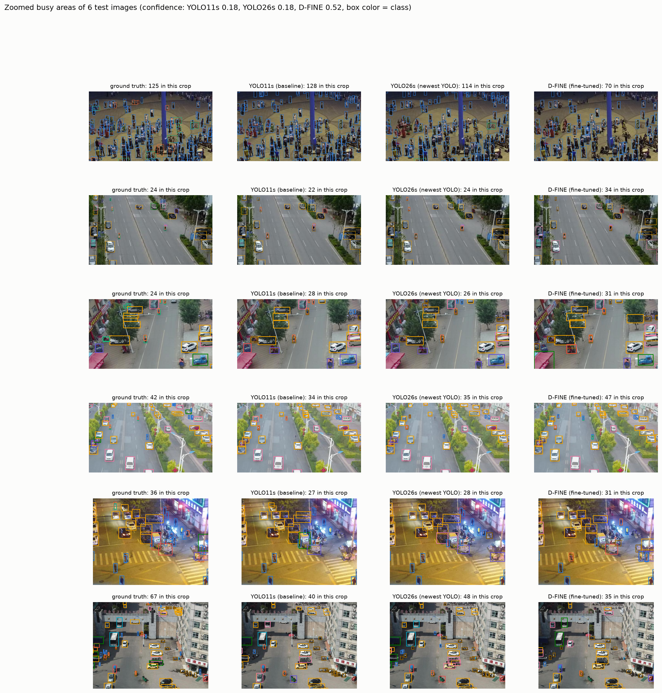

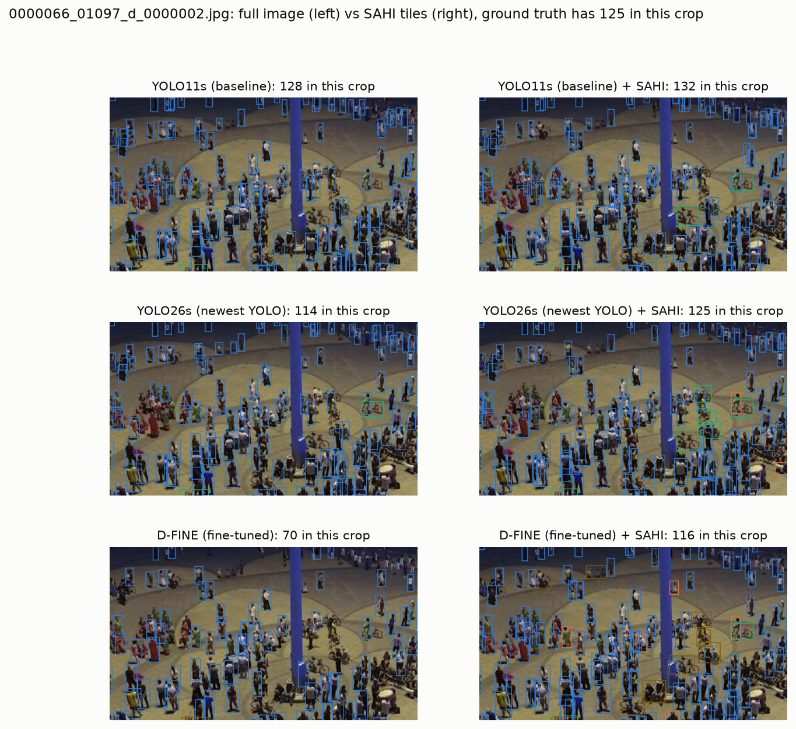

The demo does the same live: tick several models, run them on one photo or video, and they show up side by side (see [Demo](#demo)).

What the pictures show: in the very crowded square both YOLOs hit their 300-box limit while D-FINE finds fewer people, but SAHI tiles close most of that gap for D-FINE (70 to 116 people in the zoomed area). On streets with cars and scooters D-FINE often finds the most objects.

#### Files

| File | What it is |
|---|---|
| `SkyScout.ipynb` | The full project notebook (data, training, evaluation, report, demo). Run it top to bottom |
| `Demo.ipynb` | Demo only: gets the code, downloads the trained models and starts the app |
| `skyscout.py` | All the code: data, training, evaluation, report, demo, command line |
| `config.yaml` | Every hyperparameter and setting. Change values here |
| `requirements.txt` | Python packages |
| `downloads/` | Dataset and pretrained weights (downloaded once, never again) |
| `runs/` | Training checkpoints and logs |
| `models/` | Final fine-tuned models |
| `results/` | Metrics, tables, plots (`plots/`), side-by-side figures (`compare/`), demo screenshots (`screenshots/`), `STATUS.md` and `log.txt` |
| `samples/` | 6 test photos (VisDrone2019-DET test-dev) and 3 real 10 s video clips (VisDrone2019-VID val), so the demo works without the dataset |

#### How to run

The code works out where it is running and picks the matching settings in `config.yaml`:

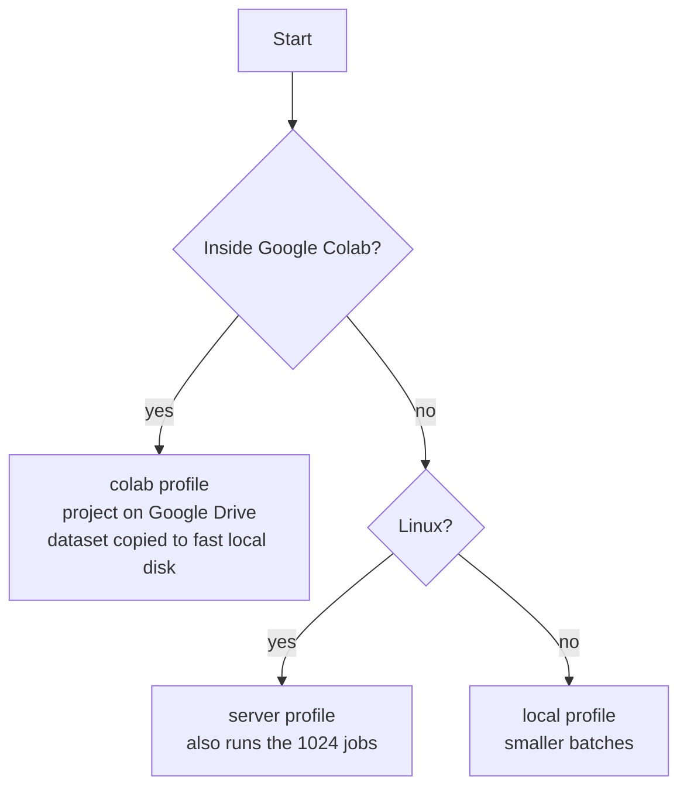

Recommended: set `SKYSCOUT_PROFILE=colab`, `server` or `local` to override the guess.

**Google Colab**
1. Open `SkyScout.ipynb` in Colab and pick a GPU runtime.
2. Run the cells in order. The first cell mounts Google Drive and clones this repo into `MyDrive/SkyScout` if it is not there yet.

Recommended: if the repo is private, upload the project folder to Google Drive as `MyDrive/SkyScout` instead.

**School server or own PC**
```bash
pip install -r requirements.txt
python skyscout.py status          # what is done and what is next
python skyscout.py all             # run everything this machine is allowed to run
python skyscout.py run yolo11s_1024
python skyscout.py time dfine_full_640
python skyscout.py eval yolo26s_640 --split test --sahi
python skyscout.py latency         # time every saved model again on this machine's GPU
python skyscout.py report
python skyscout.py compare         # side-by-side figures of the main models
python skyscout.py videos <zip>    # real demo clips from VisDrone2019-VID
python skyscout.py pack            # zip the demo models to share (see "Try the trained models")
python skyscout.py demo
```
`all` starts each experiment in its own Python process, so TensorFlow and PyTorch never fight over GPU memory, and one failed run does not stop the rest.

Recommended: if the server has more than one GPU, pick a free one with `CUDA_VISIBLE_DEVICES=1 python skyscout.py all`.

**Own Windows PC**

TensorFlow cannot use the GPU on plain Windows, so D-FINE is trained inside WSL2 (Ubuntu), which the code treats as the `local` profile. This profile uses shorter training (YOLO 50 epochs, D-FINE 6 epochs per setup) so everything fits on one consumer GPU in about a day, and it takes cooling breaks:

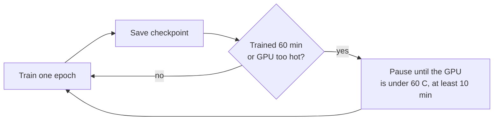

Breaks are not counted in the training time. Change or remove them with `cooldown` under `profiles: local:` in `config.yaml`.
Recommended: on the server, start long jobs with `nohup python skyscout.py all > results/server_run.txt 2>&1 &` so they keep going after you log out.

#### Interruptions and moving between machines

Nothing is lost when Colab disconnects or you switch machines:

- YOLO saves `last.pt` every epoch and continues from it. The saved paths are rewritten so it also resumes on a different machine.
- D-FINE saves the full training state (weights, optimizer, epoch) every epoch and continues from it.
- Evaluation saves its detections every 200 images and continues from there.
- Each step (train, evaluate, SAHI) writes a small file in `results/progress/` with its status, the current epoch and the time spent so far. Finished steps are skipped.
- Downloads are checked first, so nothing is downloaded twice.
- `results/STATUS.md` shows what is done on which machine.

Recommended: when you move to another machine, copy the `runs/`, `models/` and `results/` folders along with the code. Copying `downloads/` too saves the download time.

#### Demo

`python skyscout.py demo` (or `Demo.ipynb`) opens a web app for trying the models out. The scores were already measured in the evaluation step, the app shows them to help pick models.

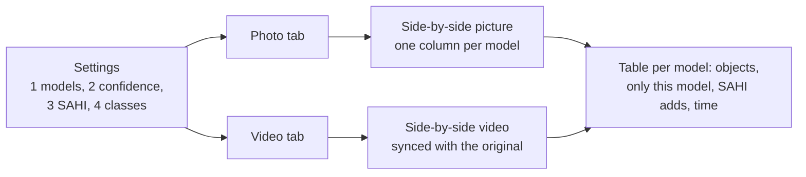

- **1 Models:** tick one or more. One click runs all of them.
- **2 Confidence:** one slider per selected model, each starting at that model's best value (best F1 on the test set, the score scales differ between models). Tick **Same value for all models** for one shared slider, the ↺ button of a slider puts it back to the best value. Left = more boxes (finds more, more false alarms), right = fewer, surer boxes (more precise, misses more).
- **3 Tiled inference (SAHI):** cuts the image into overlapping zoomed-in tiles, runs the model on each tile and on the whole image, then joins the boxes. Off, on, or **Compare**, which runs every model with and without tiles (second row of the picture).
- **4 Classes:** the box colors. Turn classes off to hide them everywhere (pictures, counts, comparisons) without running the models again.
- Under the settings: a table of all models (best value per column in green) and every score of the selected models side by side.
- **Side by side:** one column per model, a label above each window ("D-FINE + SAHI: 107 objects | 17 only here | SAHI adds 25") and a table below with one column per model in the same order, the best model of each row in green. Fullscreen and download buttons sit at the top right of the picture (the video player has its own fullscreen).
- **Saved results:** every result is kept per model, SAHI setting and confidence. Going back to a setting you already ran shows it at once (also the drawn video), only new settings need **Run selected models**. **Re-run fresh** ignores the saved results and runs everything again.
- **Highlight differences:** magenta = boxes only that model found, compared with the other models in the same row (no box of theirs overlaps it by 50% or more). Shared boxes turn grey.
- **Show what SAHI adds:** lime = boxes found with tiles but not on the full image by the same model.
- **Video:** the side-by-side result is one video, so all windows always play together, and the original plays, pauses and seeks together with it. The line chart shows objects per frame per model. Counts are per frame (no tracking), so a car seen in 10 frames counts 10 times.
- **Samples:** 6 test photos and 3 real drone videos are in `samples/`. VisDrone2019-DET only has still photos (frames seconds apart), so the clips come from the separate VisDrone2019-VID set: download `VisDrone2019-VID-val.zip` (1.5 GB, link on the [VisDrone page](https://github.com/VisDrone/VisDrone-Dataset)) and run `python skyscout.py videos <path to the zip>` to make them again. Any other `.mp4` in `downloads/samples/` shows up as an example too.

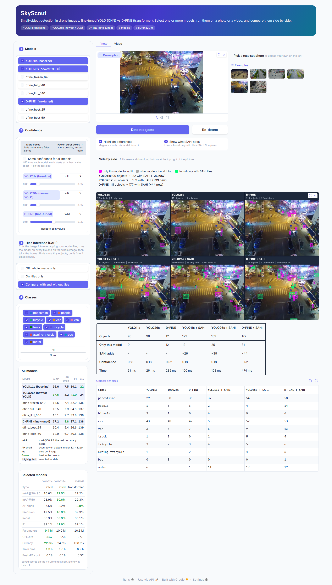

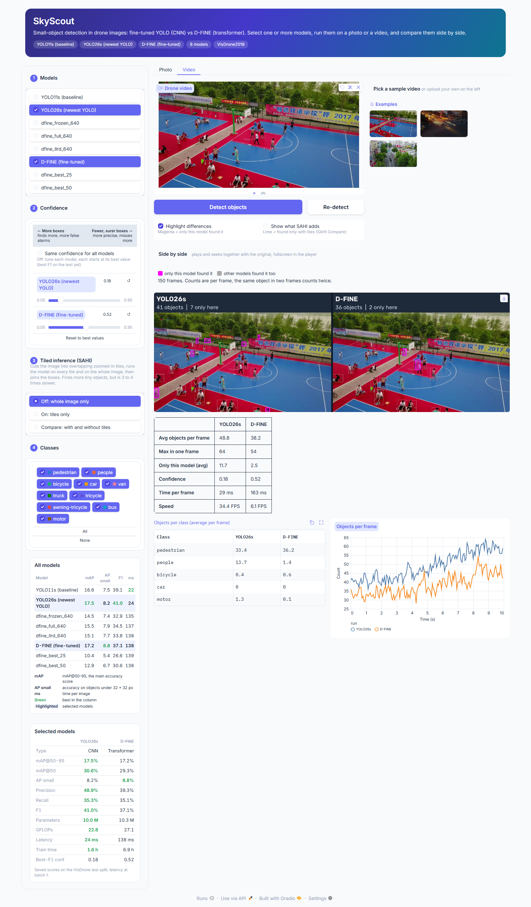

Recommended: on the school server, open the demo through an SSH tunnel (`ssh -L 7860:localhost:7860 ...`) and go to `http://localhost:7860`.

#### Try the trained models on Google Colab

`Demo.ipynb` only runs the demo. It does not need the dataset, Google Drive or any training. It downloads the trained models (YOLO11s, YOLO26s and the fine-tuned D-FINE, about 80 MB) from this repo's [release](https://github.com/fnmoral/skyscout-small-object-detection-yolo-vs-dfine-visdrone/releases/tag/models-v1) and checks the file against the SHA-256 in `config.yaml` before unzipping it.

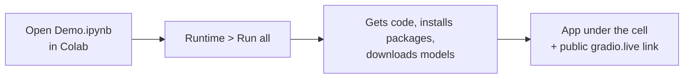

**Way 1: Colab in the browser**

1. Click the **Open in Colab** badge at the top of this page (or open `Demo.ipynb` from GitHub in Colab). The notebook asks for a GPU runtime by itself.
2. Click **Runtime > Run all**. Colab warns that the notebook is not from Google, click **Run anyway**.
3. Wait a few minutes for the install and the model download.
4. The app shows up under the last cell, and a link like `https://xxxx.gradio.live` is printed. The link works in any browser tab or on a phone while the Colab session is running.

**Way 2: VS Code connected to a Colab runtime**

1. In VS Code, install the **Google Colab** extension (by Google) and open `Demo.ipynb` from your copy of the repo.
2. Click **Select Kernel** (top right) > **Colab** > **New Colab Server**, pick a **GPU** (T4) and sign in with your Google account. The cells now run on a Colab machine, not on your computer.
3. Click **Run All**.
4. Open the printed `https://xxxx.gradio.live` link in your browser. The `http://127.0.0.1:7860` link points to the Colab machine, so it does not open on your computer.

Stop the app with the stop button of the cell (or Runtime > Interrupt execution). Running the last cell again closes the old app first.

Running the notebook again always loads the newest code from GitHub (the first cell prints the code version it uses), so there is no need to start a new session after an update.

Recommended: if no free GPU is available, the demo still runs on CPU, only slower (a few seconds per image for D-FINE).

**Using your own trained models.** After training, `python skyscout.py pack` writes `downloads/skyscout_models.zip` and prints its SHA-256 (YOLO checkpoints are cleaned: optimizer, file paths and time zone removed; D-FINE is saved without optimizer state). Put it on a release of your own copy and set `demo.models_url` and `demo.models_sha256` in `config.yaml`, or upload it to Google Drive and run `sk.fetch_models('/content/drive/MyDrive/skyscout_models.zip')` from `SkyScout.ipynb` (section 11) after mounting Drive.

#### Licences and intended use

- The trained models are shared for research and education only.
- YOLO11s and YOLO26s fine-tuned weights come from Ultralytics models, which are under the [AGPL-3.0 licence](https://www.ultralytics.com/license).
- D-FINE comes from KerasHub (Apache 2.0).
- VisDrone2019-DET (also the images and the clip in `samples/`) is for academic, non-commercial use, see the [VisDrone dataset page](https://github.com/VisDrone/VisDrone-Dataset).

#### A note on D-FINE in KerasHub

Two changes were needed to fine-tune D-FINE from KerasHub on this dataset:

- The built-in training loss treats empty padding slots as real objects and mixes up objects between images in a batch. SkyScout uses a corrected loss (`SkyDFine` in `skyscout.py`).
- Loading the preset with a new number of classes throws away the pretrained weights. SkyScout copies them over itself, so only the new class layers start from scratch.
