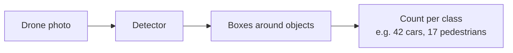
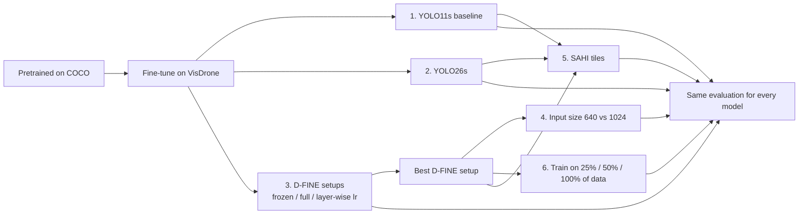
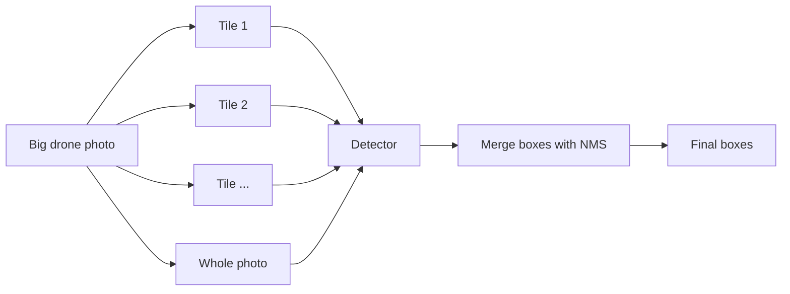
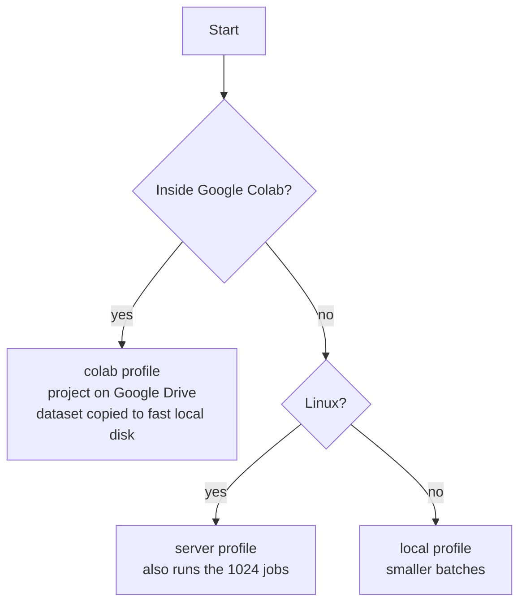

### SkyScout

**Fine-Tuning and Benchmarking YOLO and Transformer Detectors for Small-Object Detection in Drone Imagery**

Francis Neil Moral, TensorFlow II course project, Fanshawe College

#### What is this project about?

Drones take photos from high up, so people, bikes and cars look tiny. Most object detectors are trained on normal photos where objects are big, so they miss a lot of these tiny things.

SkyScout takes three ready-made detectors that already know common objects, teaches them to find 10 kinds of road objects in drone photos, and then checks which one is the most accurate and which one is the fastest.



#### The three detectors

| Model | Type in plain words | Why it is here |
|---|---|---|
| YOLO11s | A fast CNN that looks at the image once. Needs an extra clean-up step (NMS) to remove duplicate boxes | Baseline, same as the class example |
| YOLO26s | The newest YOLO. Also looks once, but no clean-up step needed | Shows how much newer YOLO helps |
| D-FINE Small | A transformer that treats detection as "fill in a list of objects". End-to-end, anchor-free, no clean-up step | The TensorFlow/Keras part of the project |

All three are about the same size (around 10 million parameters), so the comparison is fair.

```mermaid
flowchart TB
    subgraph YOLO["YOLO11s (CNN)"]
        y1[Image] --> y2[CNN backbone] --> y3[Many candidate boxes] --> y4[NMS removes duplicates] --> y5[Final boxes]
    end
    subgraph Y26["YOLO26s (CNN, NMS-free)"]
        n1[Image] --> n2[CNN backbone] --> n3[One box per object] --> n5[Final boxes]
    end
    subgraph DF["D-FINE (transformer)"]
        d1[Image] --> d2[CNN backbone] --> d3[Transformer encoder] --> d4[Decoder with 300 object queries] --> d5[Final boxes]
    end
```



#### The data: VisDrone2019-DET

- About 10,000 drone photos from Chinese cities, mostly around 2000 x 1500 pixels
- 10 classes: pedestrian, people, bicycle, car, van, truck, tricycle, awning-tricycle, bus, motor
- Most objects are smaller than 32 x 32 pixels, which is what makes this dataset hard. The exact counts per split and class are written to `results/dataset_summary.md` when the data is prepared.

#### What we test



1. **Baseline:** YOLO11s at 640 px
2. **Newest YOLO:** YOLO26s at 640 px
3. **D-FINE fine-tuning setups:** train only the head (frozen backbone), train everything, or train everything with smaller learning rates for the early layers (layer-wise learning rate decay). The winner is trained longer.
4. **Bigger input:** 640 vs 1024 px. Bigger input keeps tiny objects bigger, but costs more time.
5. **SAHI tiled inference:** cut the photo into overlapping tiles, detect on each tile, then join the results. Like using a magnifying glass on each part of the photo.
6. **Data efficiency:** how good is D-FINE with only a quarter or half of the training photos?



#### How we score the models

| Score | Meaning |
|---|---|
| mAP@50 | How well boxes are found when a loose overlap (50%) counts as correct |
| mAP@50-95 | Same, averaged over loose to very strict overlaps. The main score |
| AP small | mAP@50-95 for objects under 32 x 32 pixels only |
| Precision | Of the boxes the model drew, how many were right |
| Recall | Of the real objects, how many the model found |
| F1 | Balance of precision and recall |
| Latency | Milliseconds per image on the same GPU (NMS time shown separately for YOLO11) |
| Parameters / FLOPs | Model size and amount of math per image |

Every model goes through the same evaluation code on the same split. Each model gets a results card like this one in `results/<model>/test/report.md`, plus a per-class table and a confusion matrix:

| Metric | Score (%) |
|---|---|
| mAP@50 | ... |
| mAP@50-95 | ... |
| Precision | ... |
| Recall | ... |
| F1 Score | ... |
| Parameters | ... |
| FLOPs | ... |

The final comparison table and plots (accuracy vs speed, setups, input size, SAHI, data efficiency, sample predictions) are in `results/comparison.md`.

#### Files

| File | What it is |
|---|---|
| `SkyScout.ipynb` | The notebook. Run it top to bottom |
| `skyscout.py` | All the code: data, training, evaluation, report, demo, command line |
| `config.yaml` | Every hyperparameter and setting. Change values here |
| `requirements.txt` | Python packages |
| `downloads/` | Dataset and pretrained weights (downloaded once, never again) |
| `runs/` | Training checkpoints and logs |
| `models/` | Final fine-tuned models |
| `results/` | Metrics, tables, plots, `STATUS.md` and `log.txt` |

#### How to run

The code works out where it is running and picks the matching settings in `config.yaml`:



Recommended: set `SKYSCOUT_PROFILE=colab`, `server` or `local` to override the guess.

**Google Colab**
1. Upload this folder to Google Drive as `MyDrive/SkyScout`.
2. Open `SkyScout.ipynb` in Colab, pick a GPU runtime, run the cells in order.

**School server or own PC**
```bash
pip install -r requirements.txt
python skyscout.py status          # what is done and what is next
python skyscout.py all             # run everything this machine is allowed to run
python skyscout.py run yolo11s_1024
python skyscout.py time dfine_full_640
python skyscout.py eval yolo26s_640 --split test --sahi
python skyscout.py report
python skyscout.py demo
```
Recommended: on the server, start long jobs with `nohup python skyscout.py all > results/server_run.txt 2>&1 &` so they keep going after you log out.

#### Interruptions and moving between machines

Nothing is lost when Colab disconnects or you switch machines:

- YOLO saves `last.pt` every epoch and continues from it. The saved paths are rewritten so it also resumes on a different machine.
- D-FINE saves the full training state (weights, optimizer, epoch) every epoch and continues from it.
- Each step (train, evaluate, SAHI) writes a small file in `results/progress/`. Finished steps are skipped.
- Downloads are checked first, so nothing is downloaded twice.
- `results/STATUS.md` shows what is done on which machine.

Recommended: when you move to another machine, copy the `runs/`, `models/` and `results/` folders along with the code. Copying `downloads/` too saves the download time.

#### Demo

`python skyscout.py demo` (or the last notebook cell) opens a small web app: upload a drone photo, pick a model, and get the boxes plus a count for each class. Turn on tiled inference to find even smaller objects.

#### A note on D-FINE in KerasHub

Two changes were needed to fine-tune D-FINE from KerasHub on this dataset:

- The built-in training loss treats empty padding slots as real objects and mixes up objects between images in a batch. SkyScout uses a corrected loss (`SkyDFine` in `skyscout.py`).
- Loading the preset with a new number of classes throws away the pretrained weights. SkyScout copies them over itself, so only the new class layers start from scratch.
