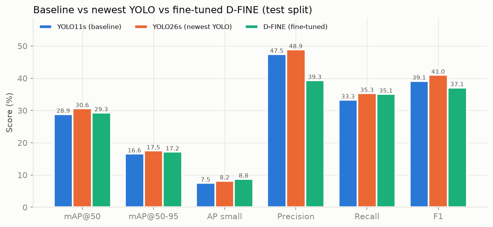
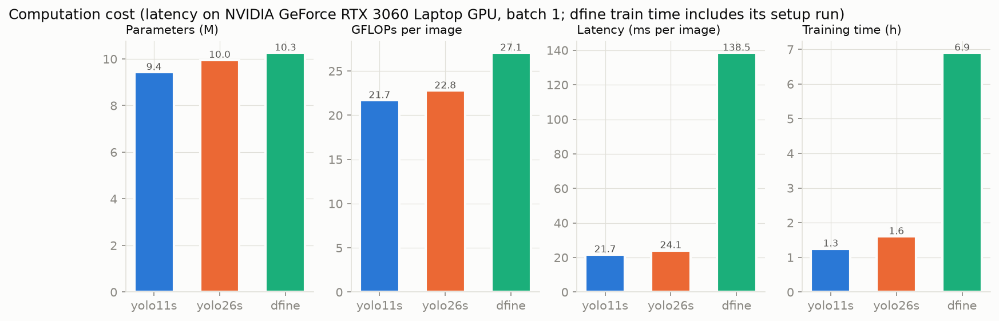
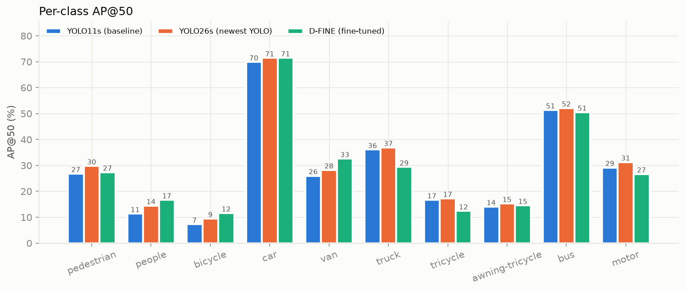
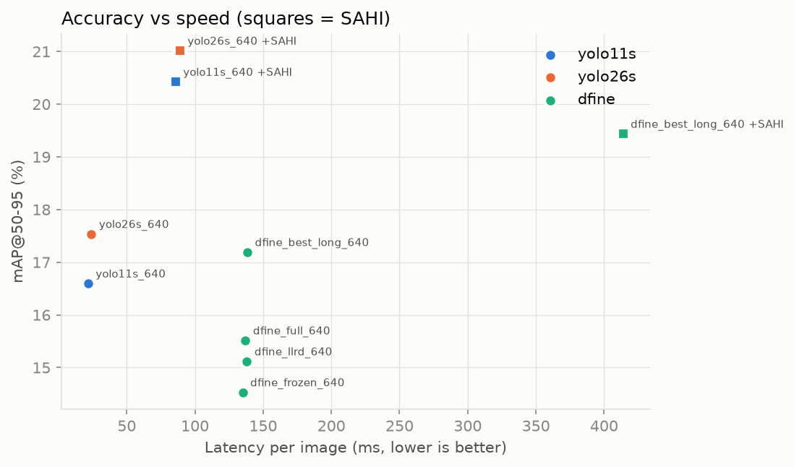
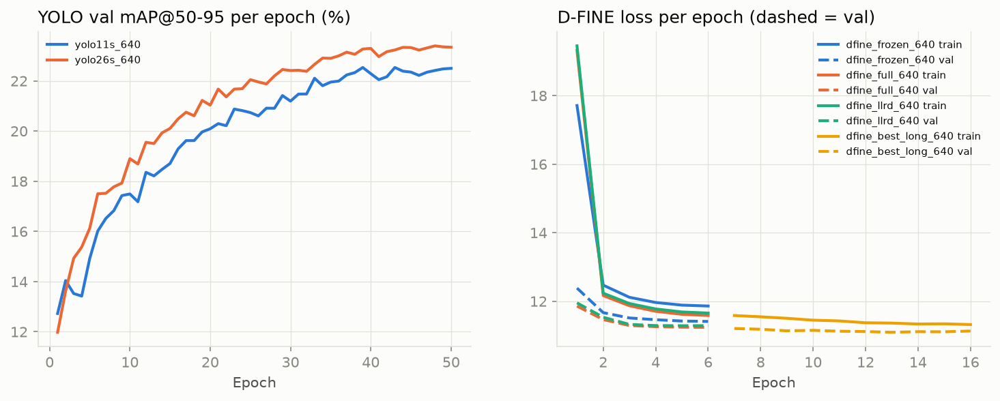
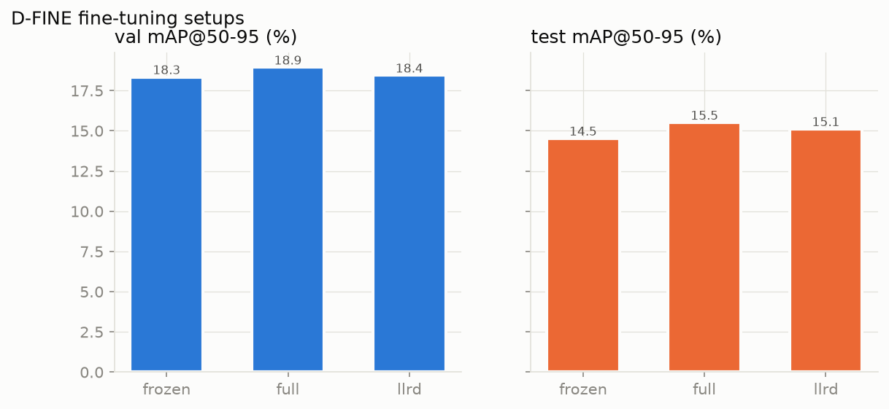
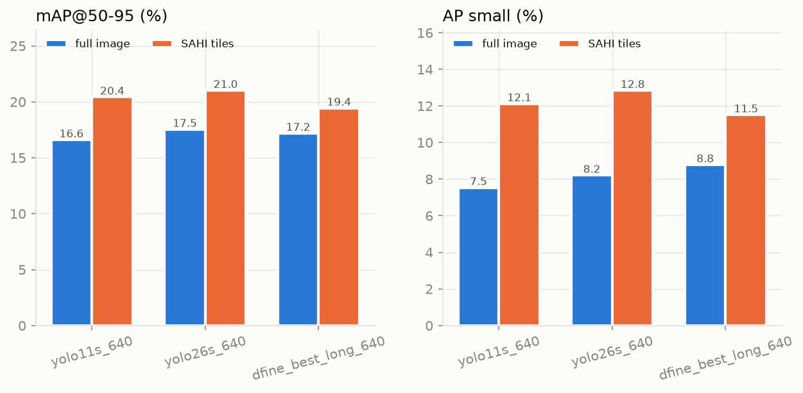
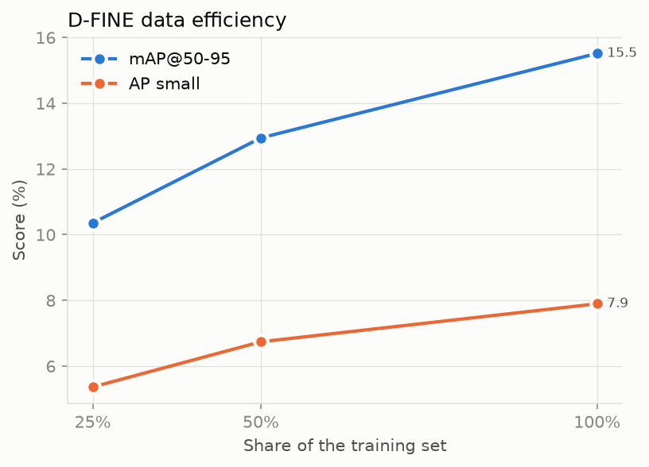
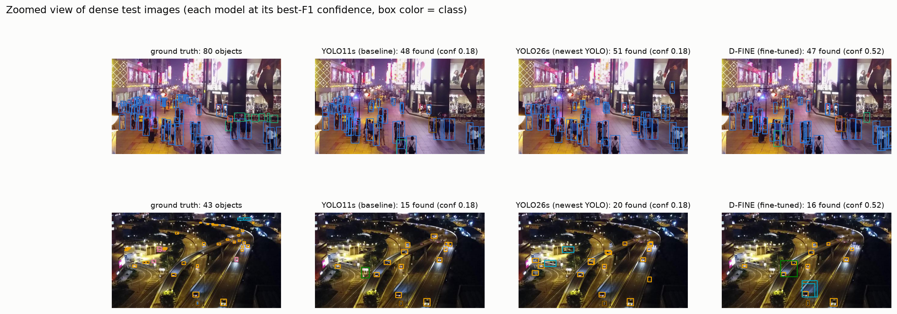
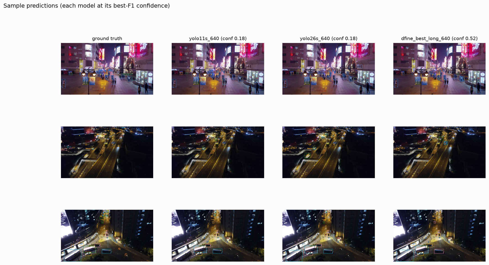

### SkyScout results

All models scored on the VisDrone-DET **test** split with the same evaluation code. Latency measured with batch 1 on: NVIDIA GeForce RTX 3060 Laptop GPU. Train time is wall time summed over all sessions, so it depends on the machine each run used. Runs that continue from another run (like the long D-FINE run) show epochs as setup + extra, and their train time includes the setup run.

#### Comparison

| Model | Setup | Input | mAP@50 | mAP@50-95 | APs | Precision | Recall | F1 | Params (M) | GFLOPs | Latency (ms) | NMS/post (ms) | Epochs | Train time (h) | Train GPU |
|---|---|---|---|---|---|---|---|---|---|---|---|---|---|---|---|
| yolo26s_640 + SAHI | fine-tune | 640 | 36.97 | 21.02 | 12.85 | 47.11 | 42.88 | 44.90 | 10.0 | 22.8 | 89.1 | 13.2 | 50 | 1.60 | NVIDIA GeForce RTX 3060 Laptop GPU |
| yolo11s_640 + SAHI | fine-tune | 640 | 35.50 | 20.43 | 12.12 | 44.18 | 42.93 | 43.54 | 9.4 | 21.7 | 85.8 | 12.8 | 50 | 1.25 | NVIDIA GeForce RTX 3060 Laptop GPU |
| dfine_best_long_640 + SAHI | full | 640 | 33.31 | 19.44 | 11.51 | 40.00 | 40.35 | 40.17 | 10.3 | 27.1 | 413.9 | 4.3 | 6+10 | 6.90 | NVIDIA GeForce RTX 3060 Laptop GPU |
| yolo26s_640 | fine-tune | 640 | 30.62 | 17.54 | 8.21 | 48.88 | 35.30 | 40.99 | 10.0 | 22.8 | 24.1 | 2.3 | 50 | 1.60 | NVIDIA GeForce RTX 3060 Laptop GPU |
| dfine_best_long_640 | full | 640 | 29.33 | 17.19 | 8.78 | 39.34 | 35.10 | 37.10 | 10.3 | 27.1 | 138.5 | 0.4 | 6+10 | 6.90 | NVIDIA GeForce RTX 3060 Laptop GPU |
| yolo11s_640 | fine-tune | 640 | 28.88 | 16.60 | 7.54 | 47.46 | 33.31 | 39.14 | 9.4 | 21.7 | 21.7 | 2.4 | 50 | 1.25 | NVIDIA GeForce RTX 3060 Laptop GPU |
| dfine_full_640 | full | 640 | 26.43 | 15.52 | 7.90 | 35.09 | 33.99 | 34.53 | 10.3 | 27.1 | 137.1 | 0.4 | 6 | 2.51 | NVIDIA GeForce RTX 3060 Laptop GPU |
| dfine_llrd_640 | llrd | 640 | 25.68 | 15.12 | 7.69 | 34.61 | 33.06 | 33.82 | 10.3 | 27.1 | 138.1 | 0.3 | 6 | 2.52 | NVIDIA GeForce RTX 3060 Laptop GPU |
| dfine_frozen_640 | frozen | 640 | 24.63 | 14.53 | 7.43 | 33.63 | 32.29 | 32.95 | 10.3 | 27.1 | 135.1 | 0.4 | 6 | 1.86 | NVIDIA GeForce RTX 3060 Laptop GPU |
| dfine_best_50 | full | 640 | 22.15 | 12.94 | 6.74 | 29.64 | 31.67 | 30.62 | 10.3 | 27.1 | 137.6 | 0.3 | 6 | 1.55 | NVIDIA GeForce RTX 3060 Laptop GPU |
| dfine_best_25 | full | 640 | 17.80 | 10.36 | 5.37 | 26.05 | 27.22 | 26.62 | 10.3 | 27.1 | 138.9 | 0.4 | 6 | 0.88 | NVIDIA GeForce RTX 3060 Laptop GPU |

#### Per-model details

- [yolo11s_640](yolo11s_640/test/report.md)
- [yolo11s_640 + SAHI](yolo11s_640/test_sahi/report.md)
- [yolo26s_640](yolo26s_640/test/report.md)
- [yolo26s_640 + SAHI](yolo26s_640/test_sahi/report.md)
- [dfine_frozen_640](dfine_frozen_640/test/report.md)
- [dfine_full_640](dfine_full_640/test/report.md)
- [dfine_llrd_640](dfine_llrd_640/test/report.md)
- [dfine_best_long_640](dfine_best_long_640/test/report.md)
- [dfine_best_long_640 + SAHI](dfine_best_long_640/test_sahi/report.md)
- [dfine_best_25](dfine_best_25/test/report.md)
- [dfine_best_50](dfine_best_50/test/report.md)
