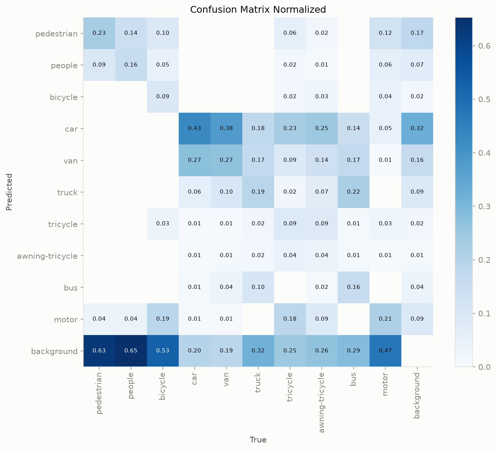

### dfine_best_25

Evaluated on the VisDrone-DET **test** split (1610 images) with the shared SkyScout evaluation code.

| Metric | Score (%) |
|---|---|
| mAP@50 | 17.80 |
| mAP@50-95 | 10.36 |
| AP small (<32 px) | 5.37 |
| Precision | 26.05 |
| Recall | 27.22 |
| F1 Score | 26.62 |
| Parameters | 10.3M |
| FLOPs | 27.1B (at 640 px) |
| Latency | 117.7 ms/img (inference 115.1, post-process 0.3) |

Training took 52.9 min on NVIDIA GeForce RTX 3060 Laptop GPU (6 epochs). Evaluation took 3.3 min on NVIDIA GeForce RTX 3060 Laptop GPU.

#### Per-class performance

| Class | mAP@50 | mAP@50-95 | AP small |
|---|---|---|---|
| pedestrian | 19.72 | 8.58 | 5.15 |
| people | 9.47 | 3.45 | 3.11 |
| bicycle | 6.17 | 2.61 | 3.10 |
| car | 61.19 | 38.54 | 24.14 |
| van | 17.37 | 11.45 | 6.11 |
| truck | 10.97 | 6.91 | 1.87 |
| tricycle | 4.42 | 2.38 | 1.00 |
| awning-tricycle | 2.54 | 1.42 | 1.18 |
| bus | 31.44 | 22.69 | 3.46 |
| motor | 14.66 | 5.53 | 4.53 |

