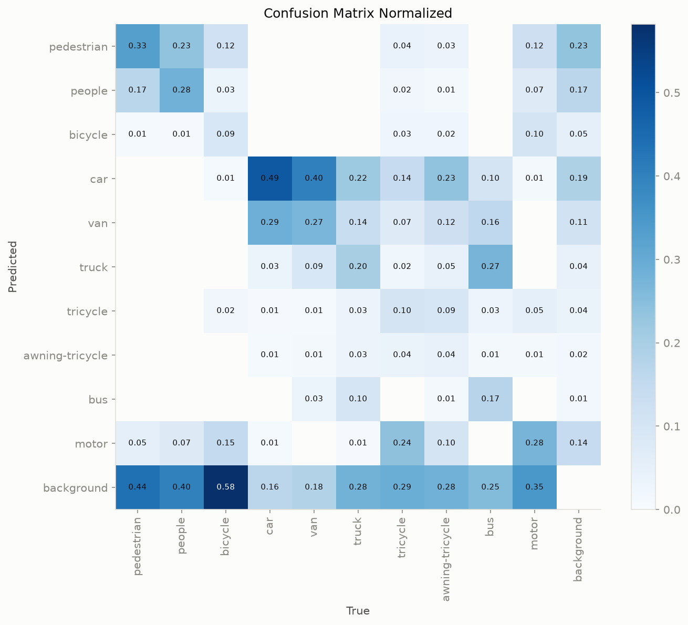

### dfine_best_25

Evaluated on the VisDrone-DET **val** split (548 images) with the shared SkyScout evaluation code.

| Metric | Score (%) |
|---|---|
| mAP@50 | 23.07 |
| mAP@50-95 | 13.68 |
| AP small (<32 px) | 7.91 |
| Precision | 30.92 |
| Recall | 31.33 |
| F1 Score | 31.13 |
| Parameters | 10.3M |
| FLOPs | 27.1B (at 640 px) |
| Latency | 117.6 ms/img (inference 115.0, post-process 0.3) |

Training took 52.9 min on NVIDIA GeForce RTX 3060 Laptop GPU (6 epochs). Evaluation took 1.3 min on NVIDIA GeForce RTX 3060 Laptop GPU.

#### Per-class performance

| Class | mAP@50 | mAP@50-95 | AP small |
|---|---|---|---|
| pedestrian | 31.48 | 14.56 | 11.04 |
| people | 21.43 | 7.89 | 7.31 |
| bicycle | 2.86 | 1.24 | 0.51 |
| car | 69.98 | 48.06 | 28.62 |
| van | 20.04 | 14.17 | 5.30 |
| truck | 13.83 | 8.85 | 3.18 |
| tricycle | 8.90 | 5.05 | 2.79 |
| awning-tricycle | 5.09 | 3.66 | 2.58 |
| bus | 29.23 | 22.25 | 7.73 |
| motor | 27.84 | 11.07 | 10.03 |

