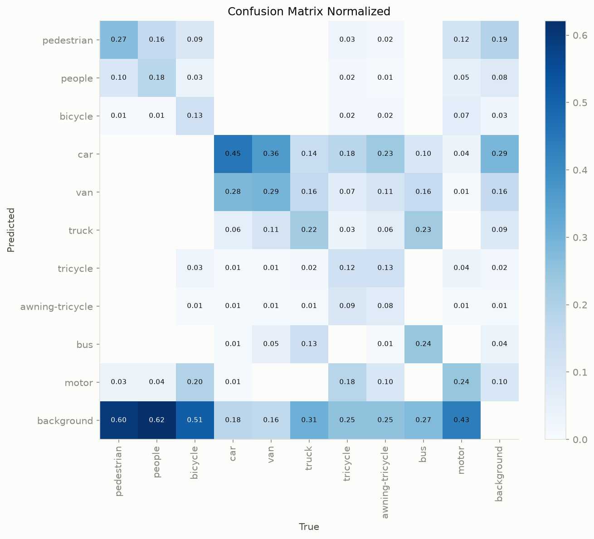

### dfine_best_50

Evaluated on the VisDrone-DET **test** split (1610 images) with the shared SkyScout evaluation code.

| Metric | Score (%) |
|---|---|
| mAP@50 | 22.15 |
| mAP@50-95 | 12.94 |
| AP small (<32 px) | 6.74 |
| Precision | 29.64 |
| Recall | 31.67 |
| F1 Score | 30.62 |
| Parameters | 10.3M |
| FLOPs | 27.1B (at 640 px) |
| Latency | 165.3 ms/img (inference 159.8, post-process 0.6) |

Training took 1.5 h on NVIDIA GeForce RTX 3060 Laptop GPU (6 epochs). Evaluation took 4.7 min on NVIDIA GeForce RTX 3060 Laptop GPU.

#### Per-class performance

| Class | mAP@50 | mAP@50-95 | AP small |
|---|---|---|---|
| pedestrian | 23.09 | 9.99 | 6.34 |
| people | 12.39 | 4.53 | 4.02 |
| bicycle | 7.72 | 3.19 | 3.38 |
| car | 66.07 | 41.97 | 27.07 |
| van | 24.50 | 16.57 | 7.72 |
| truck | 16.37 | 10.44 | 2.61 |
| tricycle | 5.97 | 3.14 | 1.63 |
| awning-tricycle | 6.94 | 4.06 | 3.39 |
| bus | 38.94 | 27.99 | 5.13 |
| motor | 19.51 | 7.56 | 6.11 |

