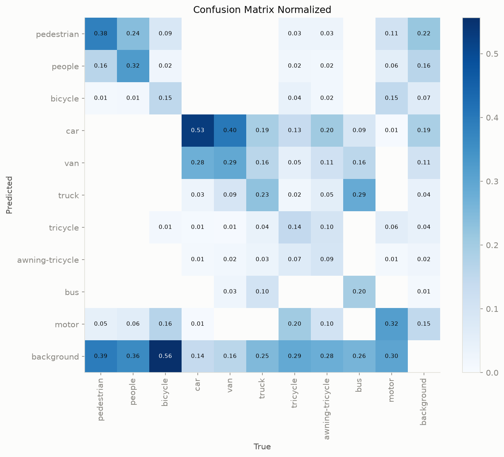

### dfine_best_50

Evaluated on the VisDrone-DET **val** split (548 images) with the shared SkyScout evaluation code.

| Metric | Score (%) |
|---|---|
| mAP@50 | 27.32 |
| mAP@50-95 | 16.14 |
| AP small (<32 px) | 9.37 |
| Precision | 35.73 |
| Recall | 33.27 |
| F1 Score | 34.46 |
| Parameters | 10.3M |
| FLOPs | 27.1B (at 640 px) |
| Latency | 138.4 ms/img (inference 134.2, post-process 0.4) |

Training took 1.5 h on local GPU (6 epochs). Evaluation took 1.7 min on local GPU.

#### Per-class performance

| Class | mAP@50 | mAP@50-95 | AP small |
|---|---|---|---|
| pedestrian | 36.20 | 16.85 | 13.13 |
| people | 26.39 | 9.90 | 9.17 |
| bicycle | 4.90 | 2.11 | 1.54 |
| car | 73.91 | 50.70 | 31.01 |
| van | 27.53 | 19.54 | 6.56 |
| truck | 17.17 | 11.18 | 3.88 |
| tricycle | 11.29 | 6.31 | 3.94 |
| awning-tricycle | 7.61 | 5.08 | 3.38 |
| bus | 34.36 | 25.66 | 8.35 |
| motor | 33.84 | 14.04 | 12.72 |

