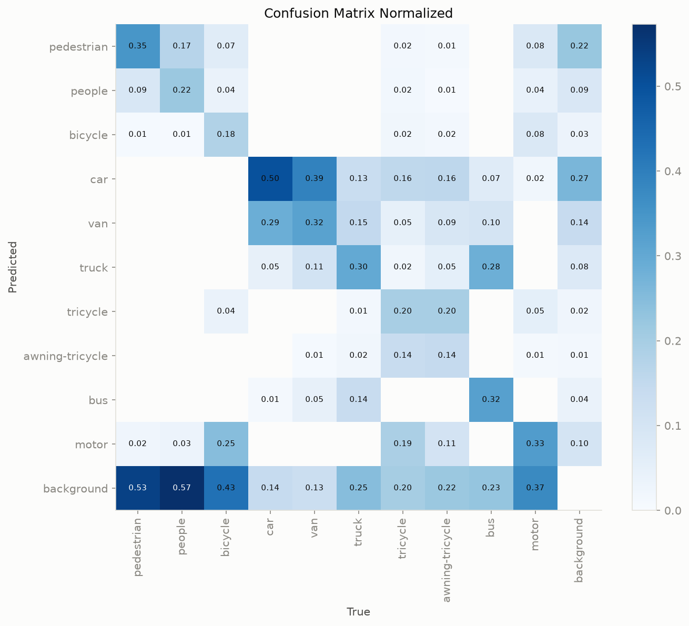

### dfine_best_long_640

Evaluated on the VisDrone-DET **test** split (1610 images) with the shared SkyScout evaluation code.

| Metric | Score (%) |
|---|---|
| mAP@50 | 29.33 |
| mAP@50-95 | 17.19 |
| AP small (<32 px) | 8.78 |
| Precision | 39.34 |
| Recall | 35.10 |
| F1 Score | 37.10 |
| Parameters | 10.3M |
| FLOPs | 27.1B (at 640 px) |
| Latency | 113.8 ms/img (inference 111.2, post-process 0.3) |

Training took 4.4 h on local GPU (10 epochs). Evaluation took 3.2 min on local GPU.

#### Per-class performance

| Class | mAP@50 | mAP@50-95 | AP small |
|---|---|---|---|
| pedestrian | 27.38 | 11.54 | 7.73 |
| people | 16.69 | 6.18 | 5.54 |
| bicycle | 11.62 | 5.08 | 4.13 |
| car | 71.48 | 45.40 | 30.14 |
| van | 32.58 | 22.10 | 9.84 |
| truck | 29.37 | 19.18 | 4.31 |
| tricycle | 12.42 | 7.10 | 3.61 |
| awning-tricycle | 14.54 | 8.27 | 6.44 |
| bus | 50.51 | 36.24 | 7.21 |
| motor | 26.68 | 10.85 | 8.88 |

