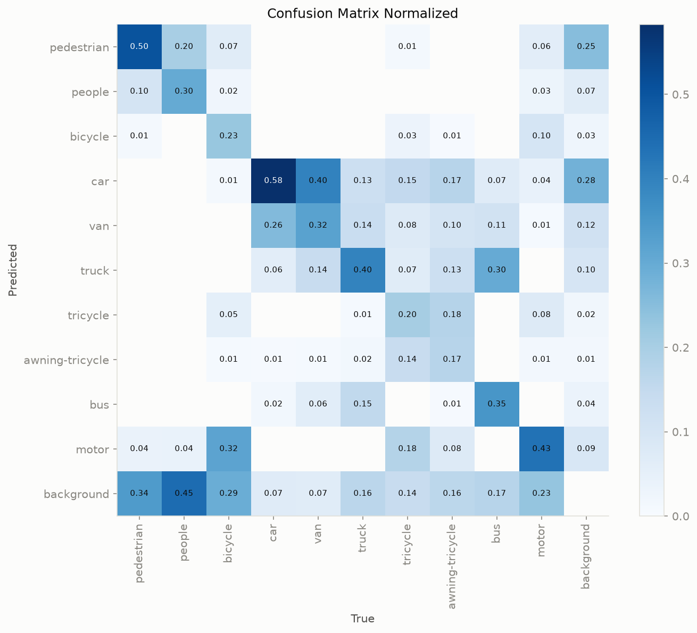

### dfine_best_long_640

Evaluated on the VisDrone-DET **test** split (1610 images) with the shared SkyScout evaluation code and SAHI tiled inference.

| Metric | Score (%) |
|---|---|
| mAP@50 | 33.31 |
| mAP@50-95 | 19.44 |
| AP small (<32 px) | 11.51 |
| Precision | 40.00 |
| Recall | 40.35 |
| F1 Score | 40.17 |
| Parameters | 10.3M |
| FLOPs | 27.1B (at 640 px) |
| Latency | 339.8 ms/img (inference 308.4, post-process 12.2) |

Training took 4.4 h on local GPU (10 epochs). Evaluation took 9.6 min on local GPU.

#### Per-class performance

| Class | mAP@50 | mAP@50-95 | AP small |
|---|---|---|---|
| pedestrian | 40.27 | 17.53 | 13.97 |
| people | 21.74 | 8.01 | 7.37 |
| bicycle | 14.69 | 6.69 | 4.40 |
| car | 74.66 | 48.16 | 35.24 |
| van | 37.05 | 26.19 | 14.40 |
| truck | 29.26 | 19.03 | 5.72 |
| tricycle | 13.24 | 7.18 | 3.85 |
| awning-tricycle | 17.15 | 10.08 | 7.20 |
| bus | 49.94 | 36.47 | 9.73 |
| motor | 35.10 | 15.02 | 13.22 |

