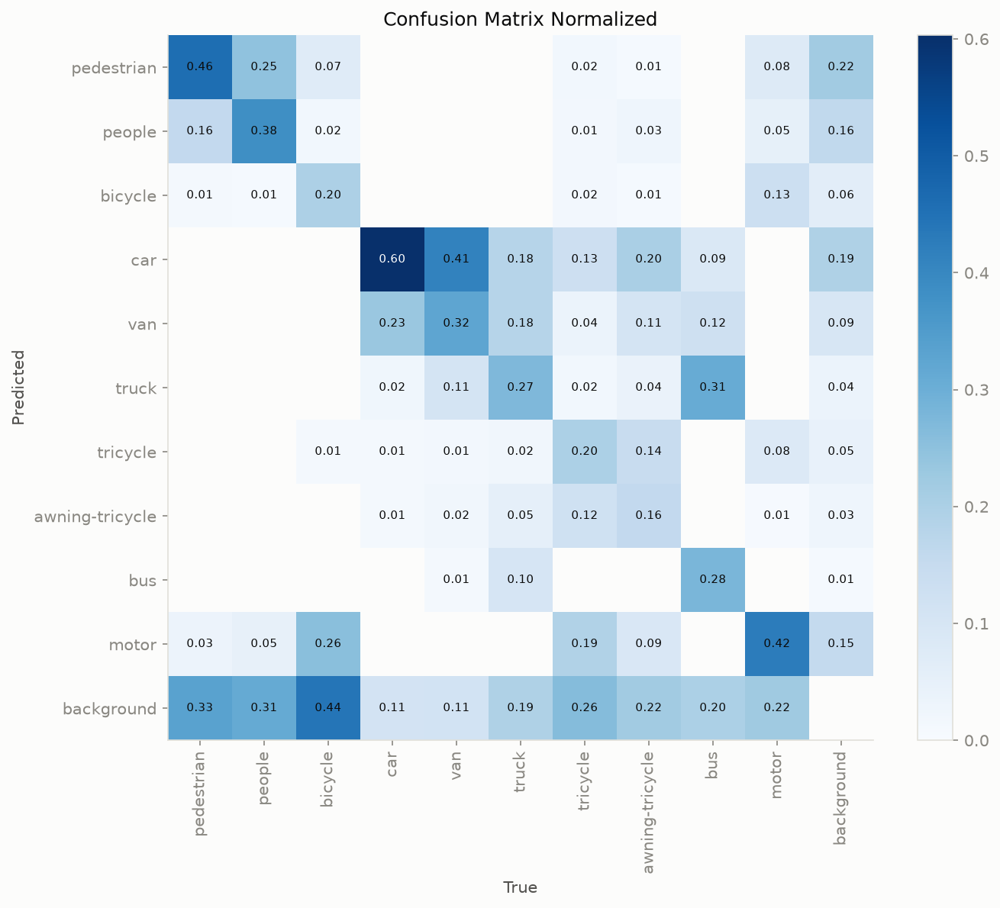

### dfine_best_long_640

Evaluated on the VisDrone-DET **val** split (548 images) with the shared SkyScout evaluation code.

| Metric | Score (%) |
|---|---|
| mAP@50 | 35.17 |
| mAP@50-95 | 20.97 |
| AP small (<32 px) | 12.84 |
| Precision | 43.94 |
| Recall | 38.84 |
| F1 Score | 41.23 |
| Parameters | 10.3M |
| FLOPs | 27.1B (at 640 px) |
| Latency | 114.4 ms/img (inference 112.0, post-process 0.3) |

Training took 4.4 h on NVIDIA GeForce RTX 3060 Laptop GPU (10 epochs). Evaluation took 1.3 min on NVIDIA GeForce RTX 3060 Laptop GPU.

#### Per-class performance

| Class | mAP@50 | mAP@50-95 | AP small |
|---|---|---|---|
| pedestrian | 41.94 | 19.93 | 15.86 |
| people | 34.03 | 13.81 | 12.70 |
| bicycle | 10.96 | 5.03 | 3.26 |
| car | 78.61 | 54.60 | 35.01 |
| van | 37.40 | 26.30 | 10.37 |
| truck | 27.51 | 18.91 | 7.05 |
| tricycle | 18.46 | 10.45 | 7.63 |
| awning-tricycle | 12.96 | 8.24 | 6.15 |
| bus | 46.69 | 33.09 | 13.43 |
| motor | 43.11 | 19.33 | 16.90 |

