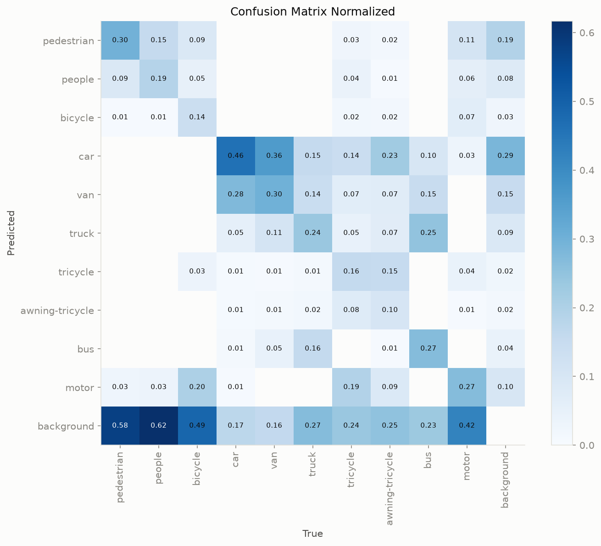

### dfine_frozen_640

Evaluated on the VisDrone-DET **test** split (1610 images) with the shared SkyScout evaluation code.

| Metric | Score (%) |
|---|---|
| mAP@50 | 24.63 |
| mAP@50-95 | 14.53 |
| AP small (<32 px) | 7.43 |
| Precision | 33.63 |
| Recall | 32.29 |
| F1 Score | 32.95 |
| Parameters | 10.3M |
| FLOPs | 27.1B (at 640 px) |
| Latency | 120.6 ms/img (inference 117.7, post-process 0.3) |

Training took 1.9 h on local GPU (6 epochs). Evaluation took 3.4 min on local GPU.

#### Per-class performance

| Class | mAP@50 | mAP@50-95 | AP small |
|---|---|---|---|
| pedestrian | 23.88 | 10.41 | 6.68 |
| people | 13.34 | 4.86 | 4.45 |
| bicycle | 9.12 | 4.11 | 3.88 |
| car | 66.90 | 42.46 | 27.46 |
| van | 28.14 | 19.00 | 8.92 |
| truck | 21.17 | 13.90 | 3.34 |
| tricycle | 9.08 | 4.98 | 2.06 |
| awning-tricycle | 9.66 | 5.62 | 4.32 |
| bus | 44.43 | 31.85 | 6.63 |
| motor | 20.61 | 8.11 | 6.59 |

