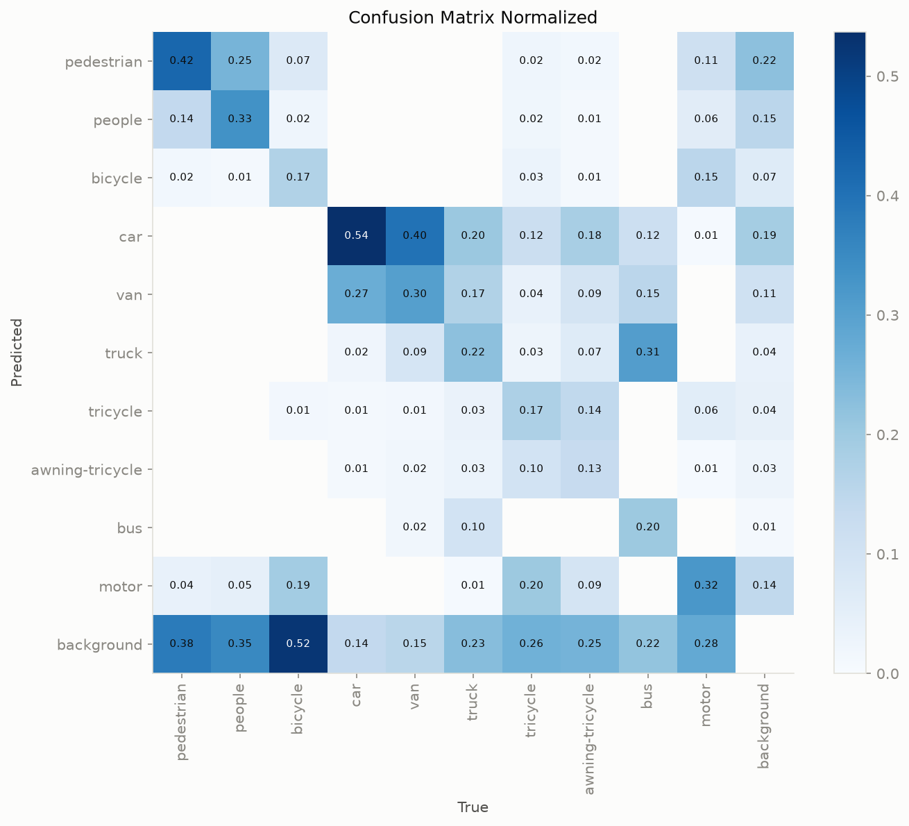

### dfine_frozen_640

Evaluated on the VisDrone-DET **val** split (548 images) with the shared SkyScout evaluation code.

| Metric | Score (%) |
|---|---|
| mAP@50 | 30.75 |
| mAP@50-95 | 18.35 |
| AP small (<32 px) | 10.59 |
| Precision | 40.02 |
| Recall | 35.22 |
| F1 Score | 37.47 |
| Parameters | 10.3M |
| FLOPs | 27.1B (at 640 px) |
| Latency | 116.6 ms/img (inference 114.0, post-process 0.3) |

Training took 1.9 h on NVIDIA GeForce RTX 3060 Laptop GPU (6 epochs). Evaluation took 1.3 min on NVIDIA GeForce RTX 3060 Laptop GPU.

#### Per-class performance

| Class | mAP@50 | mAP@50-95 | AP small |
|---|---|---|---|
| pedestrian | 37.32 | 17.62 | 13.56 |
| people | 29.38 | 11.38 | 10.37 |
| bicycle | 9.00 | 4.25 | 1.84 |
| car | 74.68 | 51.48 | 31.58 |
| van | 30.28 | 21.37 | 7.96 |
| truck | 22.94 | 15.97 | 5.28 |
| tricycle | 15.71 | 9.05 | 6.33 |
| awning-tricycle | 11.49 | 7.23 | 4.86 |
| bus | 40.48 | 29.82 | 10.70 |
| motor | 36.21 | 15.27 | 13.38 |

