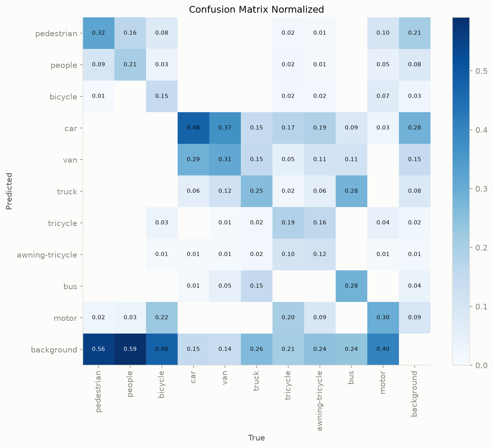

### dfine_full_640

Evaluated on the VisDrone-DET **test** split (1610 images) with the shared SkyScout evaluation code.

| Metric | Score (%) |
|---|---|
| mAP@50 | 26.43 |
| mAP@50-95 | 15.52 |
| AP small (<32 px) | 7.90 |
| Precision | 35.09 |
| Recall | 33.99 |
| F1 Score | 34.53 |
| Parameters | 10.3M |
| FLOPs | 27.1B (at 640 px) |
| Latency | 117.1 ms/img (inference 114.5, post-process 0.3) |

Training took 2.5 h on NVIDIA GeForce RTX 3060 Laptop GPU (6 epochs). Evaluation took 3.3 min on NVIDIA GeForce RTX 3060 Laptop GPU.

#### Per-class performance

| Class | mAP@50 | mAP@50-95 | AP small |
|---|---|---|---|
| pedestrian | 25.40 | 10.90 | 7.12 |
| people | 14.61 | 5.37 | 4.76 |
| bicycle | 10.57 | 4.74 | 3.99 |
| car | 69.63 | 44.34 | 29.22 |
| van | 29.90 | 20.40 | 9.10 |
| truck | 23.48 | 15.27 | 3.64 |
| tricycle | 9.07 | 5.11 | 2.23 |
| awning-tricycle | 10.92 | 5.93 | 4.15 |
| bus | 46.69 | 33.55 | 7.06 |
| motor | 24.04 | 9.54 | 7.70 |

