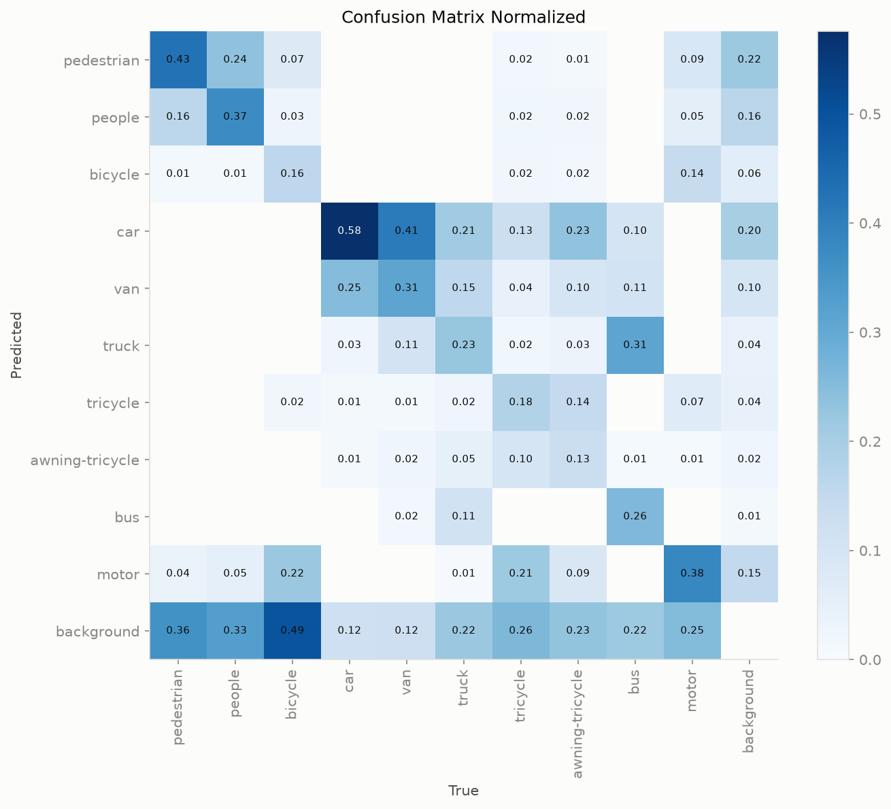

### dfine_full_640

Evaluated on the VisDrone-DET **val** split (548 images) with the shared SkyScout evaluation code.

| Metric | Score (%) |
|---|---|
| mAP@50 | 31.79 |
| mAP@50-95 | 18.94 |
| AP small (<32 px) | 11.25 |
| Precision | 41.19 |
| Recall | 36.11 |
| F1 Score | 38.48 |
| Parameters | 10.3M |
| FLOPs | 27.1B (at 640 px) |
| Latency | 118.9 ms/img (inference 116.2, post-process 0.3) |

Training took 2.5 h on NVIDIA GeForce RTX 3060 Laptop GPU (6 epochs). Evaluation took 1.3 min on NVIDIA GeForce RTX 3060 Laptop GPU.

#### Per-class performance

| Class | mAP@50 | mAP@50-95 | AP small |
|---|---|---|---|
| pedestrian | 39.36 | 18.57 | 14.66 |
| people | 30.18 | 12.45 | 11.23 |
| bicycle | 8.55 | 4.24 | 2.38 |
| car | 76.94 | 53.07 | 33.28 |
| van | 33.38 | 23.53 | 8.53 |
| truck | 22.72 | 15.39 | 5.63 |
| tricycle | 15.47 | 8.74 | 6.29 |
| awning-tricycle | 10.35 | 6.79 | 4.85 |
| bus | 42.01 | 29.80 | 10.64 |
| motor | 38.90 | 16.86 | 14.98 |

