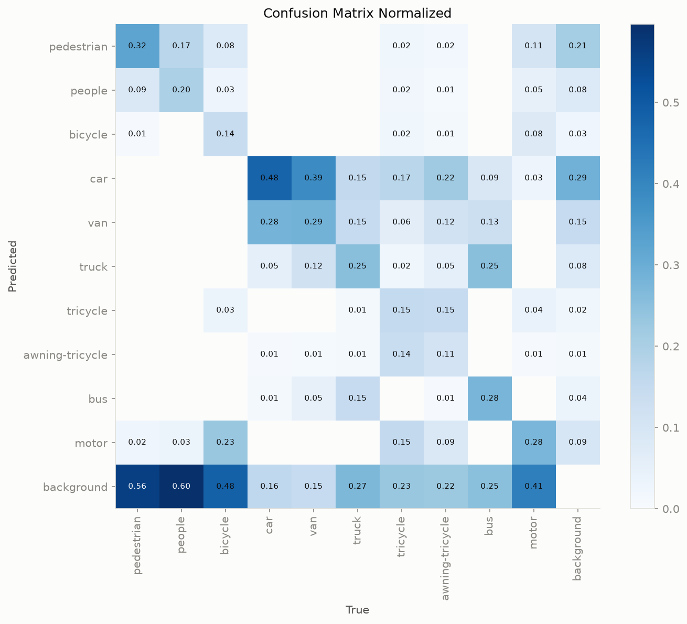

### dfine_llrd_640

Evaluated on the VisDrone-DET **test** split (1610 images) with the shared SkyScout evaluation code.

| Metric | Score (%) |
|---|---|
| mAP@50 | 25.68 |
| mAP@50-95 | 15.12 |
| AP small (<32 px) | 7.69 |
| Precision | 34.61 |
| Recall | 33.06 |
| F1 Score | 33.82 |
| Parameters | 10.3M |
| FLOPs | 27.1B (at 640 px) |
| Latency | 116.8 ms/img (inference 114.2, post-process 0.3) |

Training took 2.5 h on local GPU (6 epochs). Evaluation took 3.3 min on local GPU.

#### Per-class performance

| Class | mAP@50 | mAP@50-95 | AP small |
|---|---|---|---|
| pedestrian | 25.06 | 10.81 | 7.02 |
| people | 14.08 | 5.16 | 4.55 |
| bicycle | 10.03 | 4.62 | 3.86 |
| car | 68.51 | 43.72 | 28.76 |
| van | 28.64 | 19.59 | 8.99 |
| truck | 22.61 | 14.64 | 3.33 |
| tricycle | 9.29 | 5.22 | 2.14 |
| awning-tricycle | 10.70 | 5.86 | 4.38 |
| bus | 45.37 | 32.57 | 6.65 |
| motor | 22.46 | 8.99 | 7.18 |

