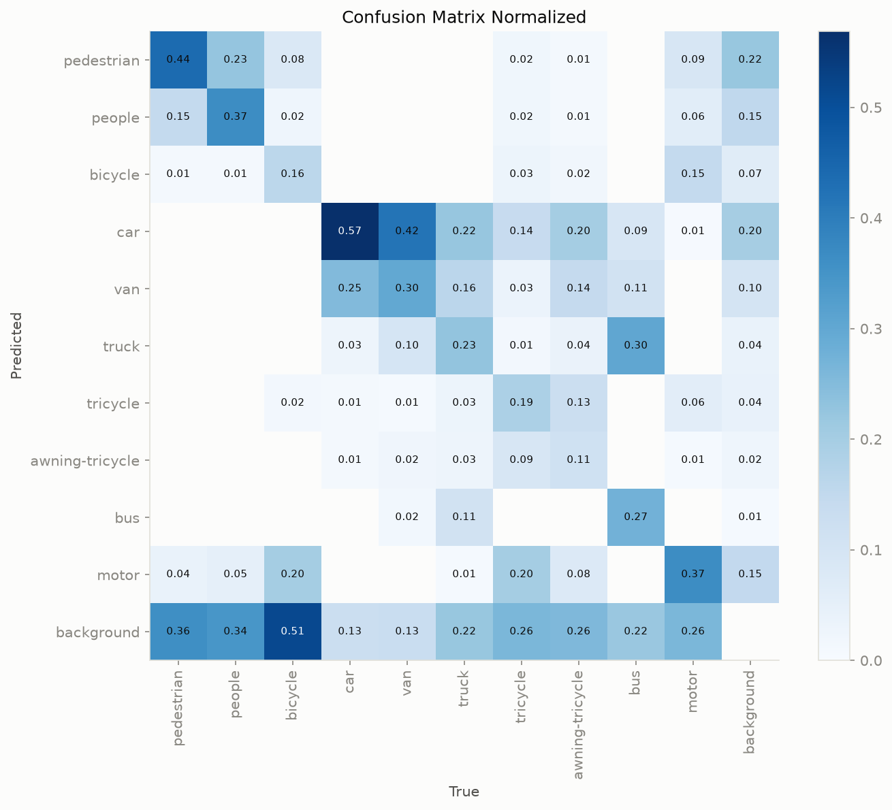

### dfine_llrd_640

Evaluated on the VisDrone-DET **val** split (548 images) with the shared SkyScout evaluation code.

| Metric | Score (%) |
|---|---|
| mAP@50 | 31.02 |
| mAP@50-95 | 18.45 |
| AP small (<32 px) | 10.83 |
| Precision | 40.63 |
| Recall | 35.40 |
| F1 Score | 37.84 |
| Parameters | 10.3M |
| FLOPs | 27.1B (at 640 px) |
| Latency | 115.5 ms/img (inference 113.0, post-process 0.3) |

Training took 2.5 h on local GPU (6 epochs). Evaluation took 1.3 min on local GPU.

#### Per-class performance

| Class | mAP@50 | mAP@50-95 | AP small |
|---|---|---|---|
| pedestrian | 38.62 | 18.13 | 14.34 |
| people | 29.71 | 11.93 | 10.98 |
| bicycle | 7.73 | 3.79 | 2.40 |
| car | 75.94 | 52.53 | 32.70 |
| van | 32.12 | 22.66 | 8.02 |
| truck | 21.92 | 14.72 | 4.94 |
| tricycle | 15.26 | 8.64 | 6.02 |
| awning-tricycle | 9.93 | 6.45 | 4.67 |
| bus | 41.03 | 29.34 | 9.63 |
| motor | 37.91 | 16.27 | 14.60 |

