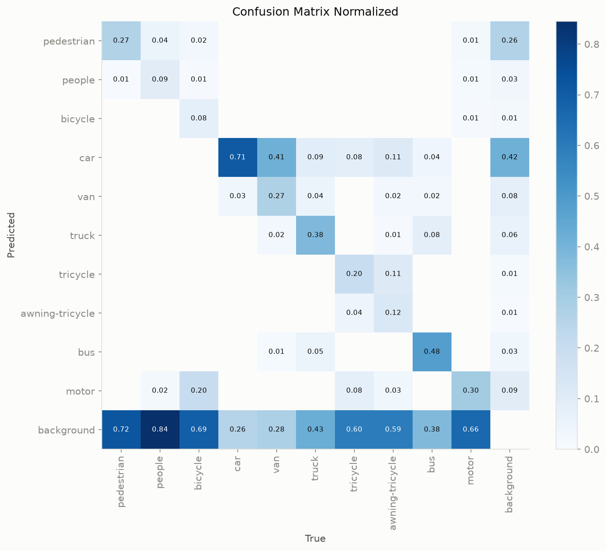

### yolo11s_640

Evaluated on the VisDrone-DET **test** split (1610 images) with the shared SkyScout evaluation code.

| Metric | Score (%) |
|---|---|
| mAP@50 | 28.88 |
| mAP@50-95 | 16.60 |
| AP small (<32 px) | 7.54 |
| Precision | 47.46 |
| Recall | 33.31 |
| F1 Score | 39.14 |
| Parameters | 9.4M |
| FLOPs | 21.7B (at 640 px) |
| Latency | 17.4 ms/img (inference 8.9, NMS 1.7) |

Training took 1.3 h on local GPU (50 epochs). Evaluation took 36 s on local GPU.

#### Per-class performance

| Class | mAP@50 | mAP@50-95 | AP small |
|---|---|---|---|
| pedestrian | 26.84 | 10.57 | 7.18 |
| people | 11.37 | 3.91 | 3.44 |
| bicycle | 7.28 | 3.30 | 1.86 |
| car | 69.90 | 43.55 | 27.74 |
| van | 26.01 | 17.92 | 6.99 |
| truck | 36.10 | 22.73 | 2.94 |
| tricycle | 16.70 | 8.82 | 4.90 |
| awning-tricycle | 14.07 | 8.19 | 3.03 |
| bus | 51.38 | 35.52 | 8.31 |
| motor | 29.18 | 11.43 | 9.00 |

