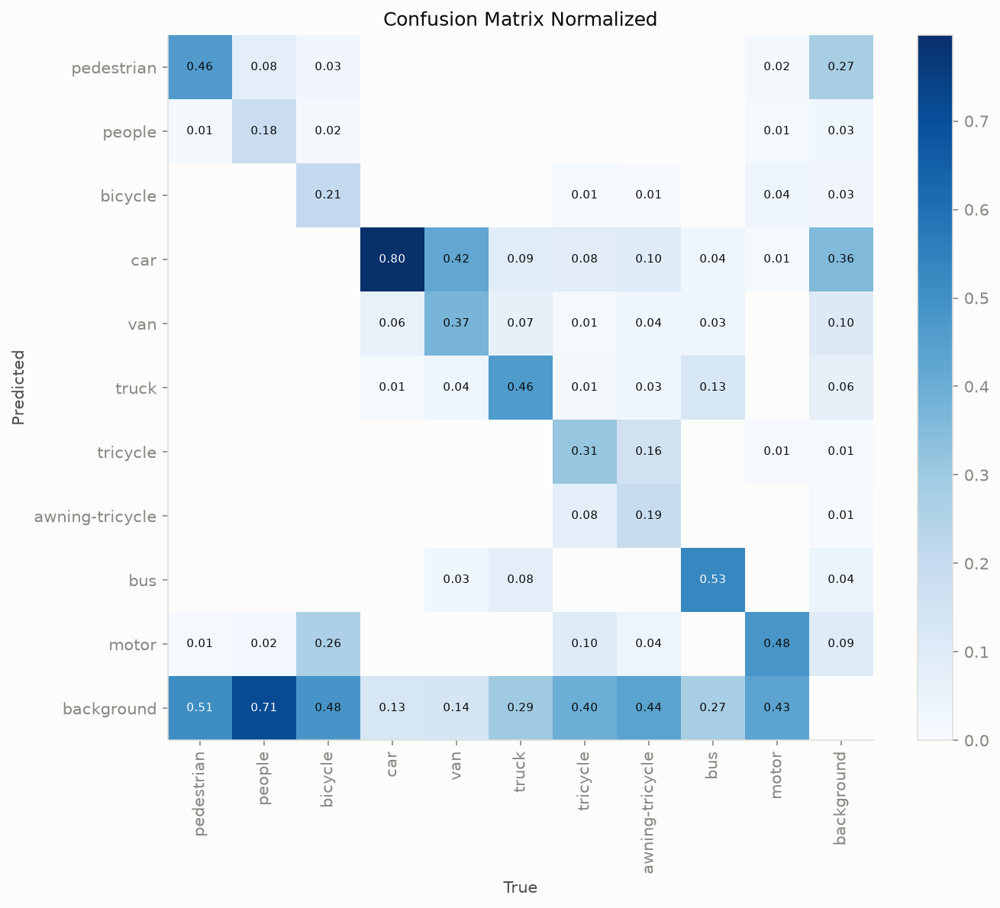

### yolo11s_640

Evaluated on the VisDrone-DET **test** split (1610 images) with the shared SkyScout evaluation code and SAHI tiled inference.

| Metric | Score (%) |
|---|---|
| mAP@50 | 35.50 |
| mAP@50-95 | 20.43 |
| AP small (<32 px) | 12.12 |
| Precision | 44.18 |
| Recall | 42.93 |
| F1 Score | 43.54 |
| Parameters | 9.4M |
| FLOPs | 21.7B (at 640 px) |
| Latency | 110.5 ms/img (inference 55.0, NMS 18.8) |

Training took 1.3 h on local GPU (50 epochs). Evaluation took 3.5 min on local GPU.

#### Per-class performance

| Class | mAP@50 | mAP@50-95 | AP small |
|---|---|---|---|
| pedestrian | 38.17 | 15.19 | 12.06 |
| people | 18.48 | 6.46 | 6.07 |
| bicycle | 14.00 | 6.33 | 4.75 |
| car | 77.07 | 49.40 | 37.11 |
| van | 36.25 | 25.15 | 13.55 |
| truck | 36.46 | 23.10 | 5.36 |
| tricycle | 23.38 | 12.52 | 8.00 |
| awning-tricycle | 19.17 | 11.48 | 7.07 |
| bus | 53.28 | 37.97 | 12.45 |
| motor | 38.72 | 16.64 | 14.79 |

