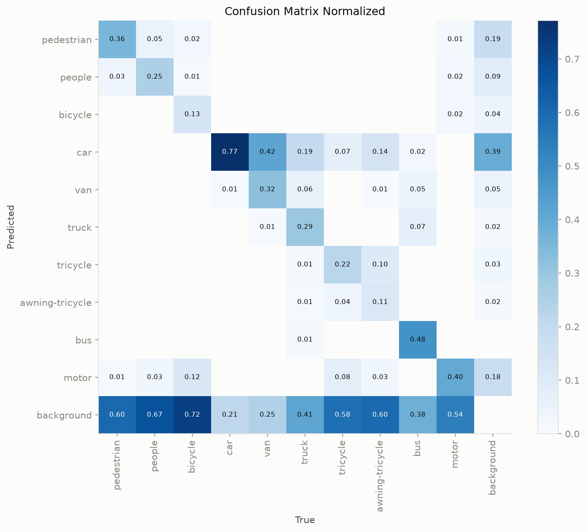

### yolo11s_640

Evaluated on the VisDrone-DET **val** split (548 images) with the shared SkyScout evaluation code.

| Metric | Score (%) |
|---|---|
| mAP@50 | 35.42 |
| mAP@50-95 | 20.82 |
| AP small (<32 px) | 11.60 |
| Precision | 51.62 |
| Recall | 39.98 |
| F1 Score | 45.06 |
| Parameters | 9.4M |
| FLOPs | 21.7B (at 640 px) |
| Latency | 15.7 ms/img (inference 8.8, NMS 1.6) |

Training took 1.3 h on local GPU (50 epochs). Evaluation took 11 s on local GPU.

#### Per-class performance

| Class | mAP@50 | mAP@50-95 | AP small |
|---|---|---|---|
| pedestrian | 40.91 | 17.86 | 13.94 |
| people | 28.87 | 10.45 | 9.27 |
| bicycle | 10.78 | 4.78 | 2.85 |
| car | 77.68 | 53.04 | 32.84 |
| van | 33.25 | 24.46 | 7.75 |
| truck | 31.96 | 21.58 | 6.45 |
| tricycle | 25.21 | 13.81 | 8.98 |
| awning-tricycle | 10.21 | 6.30 | 3.77 |
| bus | 50.89 | 36.92 | 13.90 |
| motor | 44.47 | 19.06 | 16.31 |

