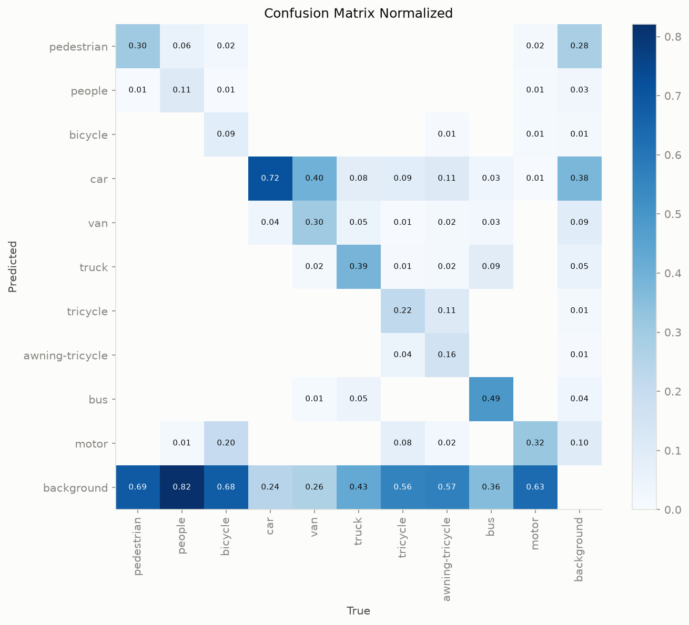

### yolo26s_640

Evaluated on the VisDrone-DET **test** split (1610 images) with the shared SkyScout evaluation code.

| Metric | Score (%) |
|---|---|
| mAP@50 | 30.62 |
| mAP@50-95 | 17.54 |
| AP small (<32 px) | 8.21 |
| Precision | 48.88 |
| Recall | 35.30 |
| F1 Score | 40.99 |
| Parameters | 10.0M |
| FLOPs | 22.8B (at 640 px) |
| Latency | 18.7 ms/img (inference 10.1, post-process 1.7) |

Training took 1.6 h on local GPU (50 epochs). Evaluation took 39 s on local GPU.

#### Per-class performance

| Class | mAP@50 | mAP@50-95 | AP small |
|---|---|---|---|
| pedestrian | 29.78 | 11.95 | 8.35 |
| people | 14.45 | 4.85 | 4.25 |
| bicycle | 9.43 | 3.87 | 2.33 |
| car | 71.46 | 44.60 | 29.70 |
| van | 28.23 | 19.67 | 8.39 |
| truck | 36.90 | 23.72 | 3.78 |
| tricycle | 17.25 | 9.00 | 4.33 |
| awning-tricycle | 15.28 | 8.73 | 3.74 |
| bus | 52.12 | 36.52 | 7.22 |
| motor | 31.26 | 12.45 | 9.97 |

