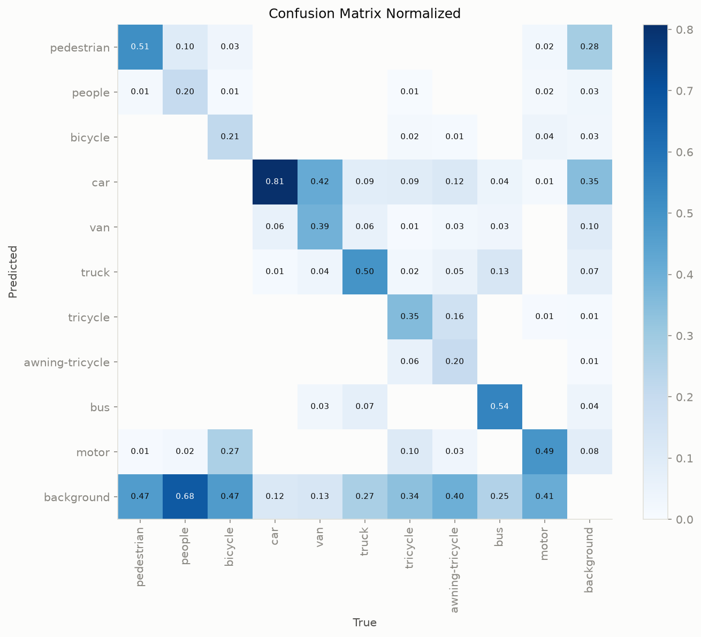

### yolo26s_640

Evaluated on the VisDrone-DET **test** split (1610 images) with the shared SkyScout evaluation code and SAHI tiled inference.

| Metric | Score (%) |
|---|---|
| mAP@50 | 36.97 |
| mAP@50-95 | 21.02 |
| AP small (<32 px) | 12.85 |
| Precision | 47.11 |
| Recall | 42.88 |
| F1 Score | 44.90 |
| Parameters | 10.0M |
| FLOPs | 22.8B (at 640 px) |
| Latency | 93.3 ms/img (inference 49.1, post-process 13.9) |

Training took 1.6 h on NVIDIA GeForce RTX 3060 Laptop GPU (50 epochs). Evaluation took 2.7 min on NVIDIA GeForce RTX 3060 Laptop GPU.

#### Per-class performance

| Class | mAP@50 | mAP@50-95 | AP small |
|---|---|---|---|
| pedestrian | 42.02 | 17.21 | 13.70 |
| people | 19.75 | 6.73 | 6.76 |
| bicycle | 15.23 | 6.68 | 4.61 |
| car | 77.92 | 49.26 | 37.19 |
| van | 38.09 | 26.56 | 15.82 |
| truck | 38.78 | 24.80 | 7.06 |
| tricycle | 24.92 | 12.94 | 7.99 |
| awning-tricycle | 18.25 | 10.44 | 6.93 |
| bus | 54.19 | 38.36 | 13.04 |
| motor | 40.56 | 17.19 | 15.35 |

