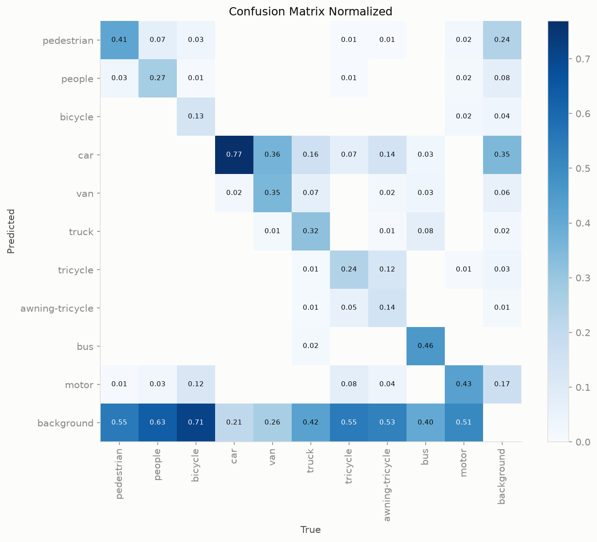

### yolo26s_640

Evaluated on the VisDrone-DET **val** split (548 images) with the shared SkyScout evaluation code.

| Metric | Score (%) |
|---|---|
| mAP@50 | 37.02 |
| mAP@50-95 | 21.82 |
| AP small (<32 px) | 12.38 |
| Precision | 52.70 |
| Recall | 40.78 |
| F1 Score | 45.98 |
| Parameters | 10.0M |
| FLOPs | 22.8B (at 640 px) |
| Latency | 16.9 ms/img (inference 9.9, post-process 1.6) |

Training took 1.6 h on NVIDIA GeForce RTX 3060 Laptop GPU (50 epochs). Evaluation took 12 s on NVIDIA GeForce RTX 3060 Laptop GPU.

#### Per-class performance

| Class | mAP@50 | mAP@50-95 | AP small |
|---|---|---|---|
| pedestrian | 44.18 | 19.83 | 15.92 |
| people | 31.86 | 11.88 | 11.04 |
| bicycle | 11.97 | 5.19 | 3.00 |
| car | 78.17 | 53.39 | 33.90 |
| van | 34.74 | 25.35 | 8.38 |
| truck | 35.71 | 24.68 | 8.58 |
| tricycle | 24.97 | 13.97 | 9.45 |
| awning-tricycle | 12.97 | 8.58 | 5.81 |
| bus | 49.13 | 35.45 | 10.47 |
| motor | 46.49 | 19.87 | 17.23 |

